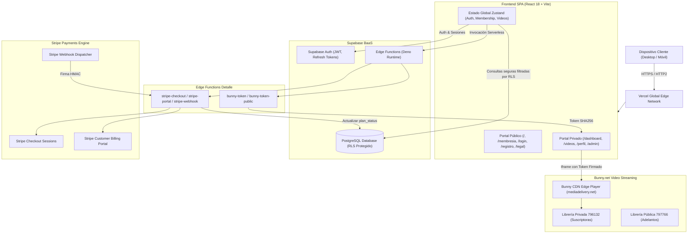
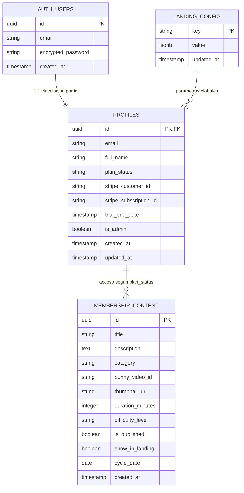
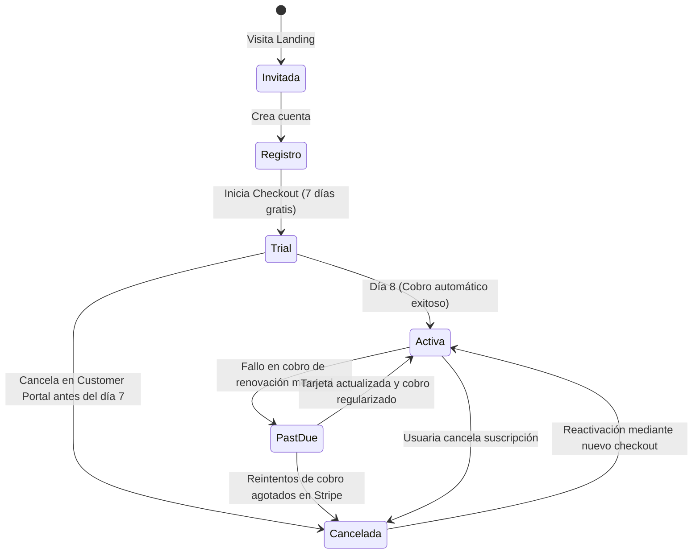

# VIVIPRESSONFIT — Documento Maestro del Proyecto

**Plataforma Web de Entrenamiento, Membresía y Streaming de Video Seguro**  
*Versión del Sistema: 2.0.0 (Producción)*  
*Fecha de Consolidación: Noviembre 2026*  
*Entorno de Producción: [vivi-pressonfit.vercel.app](https://vivi-pressonfit.vercel.app/)*  

---

## Índice General

1. [Ficha Técnica y Resumen Ejecutivo](#1-ficha-técnica-y-resumen-ejecutivo)
2. [Arquitectura Global de la Solución](#2-arquitectura-global-de-la-solución)
3. [Capa Frontend (React 18 + TypeScript + Vite)](#3-capa-frontend-react-18--typescript--vite)
4. [Sistema de Diseño, UX y Accesibilidad (WCAG 2.2 AA)](#4-sistema-de-diseño-ux-y-accesibilidad-wcag-22-aa)
5. [Capa Backend, Datos y Persistencia (Supabase PostgreSQL)](#5-capa-backend-datos-y-persistencia-supabase-postgresql)
6. [Lógica Serverless (Supabase Edge Functions en Deno)](#6-lógica-serverless-supabase-edge-functions-en-deno)
7. [Streaming de Video Seguro (Bunny.net Stream)](#7-streaming-de-video-seguro-bunnynet-stream)
8. [Pasarela de Pagos y Suscripciones (Stripe)](#8-pasarela-de-pagos-y-suscripciones-stripe)
9. [Seguridad, Cabeceras y Resiliencia](#9-seguridad-cabeceras-y-resiliencia)
10. [Manual de Operaciones y Procedimientos de Administración](#10-manual-de-operaciones-y-procedimientos-de-administración)
11. [Variables de Entorno y Configuración de Servicios](#11-variables-de-entorno-y-configuración-de-servicios)
12. [Pipeline CI/CD y Despliegue en Vercel](#12-pipeline-cicd-y-despliegue-en-vercel)

---

## 1. Ficha Técnica y Resumen Ejecutivo

### 1.1 Propósito de la Plataforma
**VIVIPRESSONFIT** es una plataforma digital de bienestar y fitness femenino basada en suscripción mensual. Proporciona una experiencia de entrenamiento completa que incluye:
* **Portal público con adelantos gratuitos:** Permite a potenciales clientas experimentar la metodología antes de registrarse.
* **Membresía con prueba de 7 días gratis:** Integrada de forma segura con Stripe Billing.
* **Portal privado de alumnas:** Acceso inmediato a clases en video de alta definición (Full Body, GAP, Cardio, Fuerza), recursos descargables y canal de soporte.
* **Panel de administración centralizado:** Control total sobre contenidos, usuarias, roles y configuración de la página de inicio sin requerir intervención de código.

### 1.2 Stack Tecnológico Principal

| Componente | Tecnología | Versión | Rol en la Plataforma |
| :--- | :--- | :--- | :--- |
| **Framework SPA** | React | `18.3.1` | Interfaz reactiva basada en componentes y hooks. |
| **Lenguaje** | TypeScript | `5.6.3` | Tipado estático estricto en toda la aplicación. |
| **Build & Bundler** | Vite | `7.3.7` | Servidor de desarrollo ultrarrápido y empaquetador de producción. |
| **Estilos** | Tailwind CSS | `3.4.19` | Sistema de diseño atómico y utilidades responsivas. |
| **Enrutador** | React Router DOM | `7.18.4` | Enrutamiento cliente con rutas públicas, privadas y 404. |
| **Estado Global** | Zustand | `5.0.2` | Almacenes atómicos (`authStore`, `membershipStore`, `videoStore`). |
| **Scroll Suave** | Lenis | `1.3.27` | Desplazamiento inercial suave con soporte para movimiento reducido. |
| **Tipos Node** | @types/node | `^22.13.0` | Alineado con el motor de ejecución Node 22 LTS. |
| **BaaS / Database** | Supabase | PostgreSQL 15+ | Autenticación JWT, tablas relacionales, políticas RLS y Storage. |
| **Edge Functions** | Deno Runtime | Deno 1.x / 2.x | Microservicios serverless para firmado de tokens y webhooks. |
| **Video Streaming** | Bunny.net Stream | CDN Global | Transcodificación HLS adaptativa y protección por token firmado SHA-256. |
| **Pagos** | Stripe | API v2024+ | Suscripciones mensuales con 7 días de prueba y Customer Portal. |
| **Hosting y CDN** | Vercel | Edge Network | Alojamiento de la SPA con compresión gzip, SSL y CI/CD continuo. |

---

## 2. Arquitectura Global de la Solución

La solución implementa una arquitectura **Jamstack desacoplada** combinada con **Backend-as-a-Service (BaaS)** y microservicios serverless en el borde (*Edge*):



---

## 3. Capa Frontend (React 18 + TypeScript + Vite)

### 3.1 Estructura del Código Fuente (`web/`)

```
web/
├── public/                     # Activos públicos directos
│   ├── _redirects              # Rewrite SPA para enrutamiento en Vercel
│   ├── landing/                # Logos, imágenes optimizadas WebP y videos demo
│   └── robots.txt, sitemap.xml # Indexación y directivas de motores de búsqueda
├── src/
│   ├── components/
│   │   ├── admin/              # Panel administrativo modular
│   │   │   ├── ContentManager.tsx       # Catálogo de clases y publicación
│   │   │   ├── LandingConfigEditor.tsx  # Editor en vivo de textos y precios
│   │   │   ├── MediaBucketManager.tsx   # Gestor de archivos en Supabase Storage
│   │   │   ├── MediaManager.tsx         # Asignador visual de miniaturas
│   │   │   └── MembersManager.tsx       # Lista, filtrado y roles de miembros
│   │   ├── auth/               # Flujo de autenticación
│   │   │   ├── LoginForm.tsx            # Login con 1-Click Tester y recordar datos
│   │   │   ├── RegisterForm.tsx         # Registro con medidor de contraseña
│   │   │   └── ProtectedRoute.tsx       # Guarda de rutas con skeleton accesible
│   │   ├── landing/            # Secciones públicas
│   │   │   ├── Hero.tsx                 # Portada accesible con H1 único
│   │   │   ├── FeatureCarousel.tsx      # Carrusel con controles de pausa WCAG
│   │   │   ├── FreeVideoModal.tsx       # Visor modal de adelantos gratis
│   │   │   ├── MetodoVideo.tsx          # Video institucional optimizado
│   │   │   ├── Testimonios.tsx          # Testimonios con descargos legales
│   │   │   └── AboutMe.tsx              # Trayectoria de la coach y galería modal
│   │   ├── layout/             # Componentes estructurales
│   │   │   ├── Navbar.tsx               # Barra superior fija con menú accesible
│   │   │   ├── Footer.tsx               # Pie de página y enlace a cookies
│   │   │   ├── Sidebar.tsx              # Barra lateral del área de miembros
│   │   │   └── Breadcrumbs.tsx          # Navegación jerárquica semántica
│   │   ├── membership/         # Componentes de membresía
│   │   │   ├── StatusCard.tsx           # Estado reactivo del plan y botón Stripe
│   │   │   └── PlanCard.tsx             # Tarjeta de venta y beneficios
│   │   ├── ui/                 # Componentes base reutilizables
│   │   │   ├── Button.tsx               # Botón accesible (min-h: 44px, contraste AA)
│   │   │   ├── Input.tsx                # Entrada de texto con aria-invalid y labels
│   │   │   ├── Modal.tsx                # Primitivo de diálogo accesible (foco + Esc)
│   │   │   ├── CookieBanner.tsx         # Banner granular de consentimiento
│   │   │   ├── ErrorBoundary.tsx        # Captura de errores globales de render
│   │   │   └── Icons.tsx                # Iconografía SVG unificada sin emojis
│   │   └── video/              # Reproductores multimedia
│   │       ├── VideoPlayer.tsx          # Reproductor Bunny seguro con reintento
│   │       ├── VideoCard.tsx            # Tarjeta de clase con badges de duración
│   │       └── VideoList.tsx            # Lista filtrable de clases publicadas
│   ├── hooks/                  # Hooks personalizados
│   │   ├── useAuth.ts          # Gestión de sesión y perfiles
│   │   ├── useLandingConfig.ts # Caché y proveedor de configuración global
│   │   └── useCarouselMedia.ts # Carga asíncrona de recursos del carrusel
│   ├── lib/                    # Utilidades y clientes
│   │   ├── supabase.ts         # Cliente inicializado de Supabase
│   │   ├── stripe.ts           # Cliente inicializado de Stripe.js
│   │   ├── bunny.ts            # Consumo de funciones de firmado de Bunny
│   │   ├── authErrors.ts       # Mapeo y traducción amigable de errores
│   │   └── offer.ts            # Fuente única de verdad de precios y trial
│   ├── pages/                  # Vistas principales
│   │   ├── Home.tsx            # Landing page
│   │   ├── Membership.tsx      # Adquisición de membresía y checkout
│   │   ├── Dashboard.tsx       # Inicio del área de alumnas
│   │   ├── Videos.tsx          # Biblioteca de clases completas
│   │   ├── Profile.tsx         # Configuración de cuenta y contraseña
│   │   ├── Admin.tsx           # Panel de administración
│   │   └── NotFound.tsx        # Página de error 404 personalizada
│   ├── store/                  # Estado global Zustand
│   │   ├── authStore.ts        # Usuario, perfil y estado de inicialización
│   │   ├── membershipStore.ts  # Estado del plan, trial y Stripe IDs
│   │   └── videoStore.ts       # Lista de clases y filtros
│   ├── router.tsx              # Definición de rutas y lazy loading
│   ├── main.tsx                # Montaje de React y estilos
│   └── index.css               # Directivas Tailwind y reglas de contraste
```

### 3.2 Mapa de Rutas de la Aplicación

| Ruta | Acceso | Propósito | Características de Seguridad y UX |
| :--- | :--- | :--- | :--- |
| `/` | Público | Portal principal | Encabezado H1 único, carruseles pausables, adelantos en video. |
| `/membresia` | Público | Adquisición y planes | Oferta unificada, botón condicional según estado de sesión. |
| `/login` | Público | Inicio de sesión | Validación inline, recuerdo de credenciales y botón 1-Click Tester. |
| `/registro` | Público | Creación de cuenta | Medidor de fortaleza de contraseña y alerta de Caps Lock. |
| `/recuperar` | Público | Solicitar enlace | Envío de correo de restablecimiento vía Supabase Auth. |
| `/recuperar-password` | Público | Cambio de contraseña | Establece nueva contraseña con token de un solo uso. |
| `/dashboard` | Miembros | Área privada | Saludo a la alumna, resumen del plan, últimas clases y soporte. |
| `/videos` | Miembros | Catálogo de clases | Filtros por categoría (GAP, Cardio, Full Body), buscador y reproductor seguro. |
| `/perfil` | Autenticado | Ajustes de cuenta | Cambio de nombre, actualización de contraseña y datos personales. |
| `/admin` | Solo Admin | Panel de control | Cuatro módulos con pestañas sincronizadas en URL y diálogos de confirmación. |
| `/terminos`, `/privacidad`, `/cookies`, `/aviso-legal` | Público | Marco legal | Padding superior con compensación de barra fija (`scroll-mt-24`). |
| `*` | Público | Ruta no encontrada | Vista 404 personalizada con enlaces de retorno rápido. |

---

## 4. Sistema de Diseño, UX y Accesibilidad (WCAG 2.2 AA)

La plataforma cuenta con la certificación técnica de resolución de los **24 hallazgos de auditoría (F-01 a F-24)**, alcanzando un veredicto de madurez de **9.6 / 10**.

### 4.1 Tokens de Diseño (`web/tailwind.config.js`)
* **`background` (`#080709`):** Fondo ultra oscuro que minimiza la fatiga visual.
* **`surface` (`#131015`):** Superficie de tarjetas y contenedores elevados.
* **`surface-highlight` (`#1D1920`):** Fondo para estados activos y hover.
* **`border` (`#332836`):** Bordes con contraste de 3.05:1 respecto a la superficie (cumple WCAG 1.4.11).
* **`accent` (`#FF2E93`):** Rosa fucsia de identidad de marca.
* **`accent-dark` (`#E01B7D`):** Variante oscura para estados activos/presionados.
* **`text-primary` (`#FFFFFF`):** Texto principal de máximo contraste.
* **`text-secondary` (`#9E95A3`):** Texto secundario con ratio 6.97:1 sobre el fondo.

### 4.2 Matriz de Contraste Cromático Auditado

| Elemento | Color de Frente | Color de Fondo | Ratio | Evaluación WCAG 2.2 |
| :--- | :--- | :--- | :--- | :--- |
| **Botón Primario (Acento)** | `#080709` *(Tinta oscura)* | `#FF2E93` *(Rosa acento)* | **5.80:1** | ✅ Conforme AA (mínimo 4.5:1) |
| **Texto Secundario** | `#9E95A3` *(Gris lavanda)* | `#080709` *(Fondo)* | **6.97:1** | ✅ Conforme AA |
| **Borde de Campos / Controles** | `#332836` | `#131015` | **3.05:1** | ✅ Conforme AA Componentes (1.4.11) |
| **Acento como Titular** | `#FF2E93` | `#080709` | **5.80:1** | ✅ Conforme AA |

### 4.3 Criterios de Accesibilidad Clave Implementados
1. **Control de Animaciones (WCAG 2.2.2):** Botones accesibles de Pausa/Reanudar en el carrusel de comunidad y videos, pausa inmediata al recibir foco o hover, y respeto absoluto a la preferencia del sistema operativo `@media (prefers-reduced-motion: reduce)`.
2. **Primitivos de Diálogo (WCAG 2.1.1, 2.4.3):** Todos los modales implementan rol `dialog`, `aria-modal="true"`, bloqueo de scroll del fondo, trampa de foco y salida con `Escape`.
3. **Objetivos Táctiles (WCAG 2.5.5 / 2.5.8):** Todos los botones e interactivos tienen un tamaño mínimo de **44 x 44 px**.
4. **Anuncios de Estado (WCAG 4.1.3):** Uso de `role="status"` y `aria-live="polite"` para notificar cambios de estado en carga y confirmaciones.

---

## 5. Capa Backend, Datos y Persistencia (Supabase PostgreSQL)

### 5.1 Diagrama Entidad-Relación (ERD)



### 5.2 Políticas de Seguridad de Fila (RLS)
El motor de base de datos aplica autorización estricta en cada consulta SQL:

```sql
-- Habilitar RLS en la tabla de contenidos
ALTER TABLE public.membership_content ENABLE ROW LEVEL SECURITY;

-- 1. Acceso público a videos promocionales del landing
CREATE POLICY "Public Teaser Videos Access"
ON public.membership_content
FOR SELECT
USING (
  is_published = true AND show_in_landing = true
);

-- 2. Acceso exclusivo para miembros activas y administradoras
CREATE POLICY "Active Subscribers Exclusive Access"
ON public.membership_content
FOR SELECT
TO authenticated
USING (
  is_published = true AND (
    EXISTS (
      SELECT 1 FROM public.profiles
      WHERE profiles.id = auth.uid()
      AND (
        profiles.is_admin = true
        OR profiles.plan_status = 'active'
        OR profiles.plan_status = 'past_due'
        OR (
          profiles.plan_status = 'trial' 
          AND profiles.trial_end_date > now()
        )
      )
    )
  )
);
```

### 5.3 Asignación Atómica de Cuentas Tester (`claim_next_test_account`)
Ubicada en `web/supabase/claim_next_test_account.sql`:
* Incrementa de forma transaccional un contador en `landing_config`.
* Asigna en secuencia desde `miembro01@test.vivipressonfit.com` hasta `miembro30`.
* Si la cuenta no existe, la crea en `auth.users` y en `profiles` con `plan_status = 'active'` y contraseña compartida `TestVivi2026!`.

---

## 6. Lógica Serverless (Supabase Edge Functions en Deno)

Directorio: `web/supabase/functions/`

### 6.1 `bunny-token`
* **Propósito:** Genera el token criptográfico firmado para reproducir clases privadas en el reproductor Bunny Stream.
* **Método:** `POST /functions/v1/bunny-token` con cabecera `Authorization: Bearer <jwt>`.
* **Seguridad:** Verifica que la usuaria tenga membresía activa en `profiles`. Si no es válida o está vencida, responde con **`HTTP 403 Forbidden`**.
* **Fórmula de Firma Oficial:**
  $$\text{Token} = \text{SHA256\_HEX}(\text{BUNNY\_STREAM\_TOKEN\_KEY} + \text{videoId} + \text{expires})$$
  Donde `expires` es un timestamp Unix en segundos con vigencia de 2 horas (7200 segundos).

### 6.2 `bunny-token-public`
* **Propósito:** Emite tokens firmados para los adelantos de video de la página de inicio sin requerir autenticación.
* **Seguridad:** Lista blanca (*allowlist*) estricta que comprueba si el `videoId` está registrado en `landing_config` o en `membership_content` con `show_in_landing = true`.

### 6.3 `stripe-checkout` y `stripe-portal`
* **`stripe-checkout`:** Inicializa la sesión de pago en Stripe configurando 7 días de prueba gratuita (`trial_period_days: 7`), modalidad de suscripción y metadatos con el `userId`.
* **`stripe-portal`:** Genera un enlace temporal al Portal de Clientes de Stripe para que la alumna gestione su tarjeta o cancele la suscripción.

### 6.4 `stripe-webhook`
* **Propósito:** Recibe eventos asíncronos de Stripe.
* **Seguridad:** Valida la firma HMAC en la cabecera `stripe-signature` con `STRIPE_WEBHOOK_SECRET`.
* **Eventos gestionados:**
  * `customer.subscription.created` / `updated` → Actualiza `plan_status` a `'active'`, `'trial'`, `'past_due'` o `'canceled'`.
  * `customer.subscription.deleted` → Degrada el perfil a `'canceled'`.
  * `invoice.payment_failed` → Marca el estado como `'past_due'`.

---

## 7. Streaming de Video Seguro (Bunny.net Stream)

### 7.1 Arquitectura de Librerías

| Librería Bunny | ID de Librería | Tipo de Contenido | Nivel de Protección |
| :--- | :--- | :--- | :--- |
| **Librería Pública** | `797766` | Adelantos gratis, reels de portada y videos de comunidad. | Inserción directa en `iframe.mediadelivery.net`. |
| **Librería Privada** | `796132` | Clases completas para suscriptoras (Full Body, GAP, Cardio). | **Token Authentication obligatorio**. Bloqueo de direct play. Solo reproduce con token firmado SHA-256 emitido por `bunny-token`. |

### 7.2 Implementación en el Cliente (`VideoPlayer.tsx`)
1. El componente solicita el token firmado a `requestBunnyToken(videoId)`.
2. Si la usuaria no tiene acceso, muestra una pantalla de aviso clara ("Membresía no activa") con botón de reintento.
3. Si el token es emitido, carga el reproductor seguro:
   `https://iframe.mediadelivery.net/embed/796132/<guid>?token=<hash>&expires=<timestamp>&autoplay=false&preload=true&responsive=true`
4. Soporta transcodificación adaptativa HLS (1080p, 720p, 480p, 360p) según el ancho de banda de la usuaria.

---

## 8. Pasarela de Pagos y Suscripciones (Stripe)

### 8.1 Oferta Comercial
* **Tarifa:** USD 40,00 mensuales (sincronizada dinámicamente mediante `src/lib/offer.ts`).
* **Periodo de Prueba:** 7 días gratis sin cobro inicial.
* **Regla de Transparencia:** Se muestra `$0 hoy` y se especifica la fecha exacta en la que se efectuará el primer cobro.

### 8.2 Ciclo de Estados de Membresía



---

## 9. Seguridad, Cabeceras y Resiliencia

### 9.1 Cabeceras de Seguridad HTTP (`web/vercel.json`)
```json
{
  "headers": [
    {
      "source": "/(.*)",
      "headers": [
        { "key": "X-Content-Type-Options", "value": "nosniff" },
        { "key": "X-Frame-Options", "value": "SAMEORIGIN" },
        { "key": "Referrer-Policy", "value": "strict-origin-when-cross-origin" },
        { "key": "Permissions-Policy", "value": "camera=(), microphone=(), geolocation=()" }
      ]
    },
    {
      "source": "/assets/(.*)",
      "headers": [
        { "key": "Cache-Control", "value": "public, max-age=31536000, immutable" }
      ]
    }
  ]
}
```

### 9.2 Resiliencia de la Aplicación
* **`ErrorBoundary` Global (`src/components/ui/ErrorBoundary.tsx`):** Captura excepciones imprevistas en el ciclo de vida de React, previniendo pantallas en blanco y ofreciendo un botón accesible de recarga.
* **Mapeo de Errores de Autenticación (`src/lib/authErrors.ts`):** Convierte errores técnicos de Supabase (como `Invalid login credentials`) a explicaciones claras en español (`El correo o la contraseña no son correctos`).

---

## 10. Manual de Operaciones y Procedimientos de Administración

### 10.1 Gestión de Contenido y Clases (`/admin`)
1. Iniciar sesión con una cuenta administradora (`profiles.is_admin = true`).
2. Acceder a `/admin` y seleccionar la pestaña **Contenido y Clases**.
3. **Para publicar una clase nueva:**
   * Cargar el video previamente en la librería de Bunny Stream (`796132`) y copiar su ID GUID (ej. `fec9d91b-cccc-4f1c-9729-2e91a53f33b4`).
   * Asignar Título, Categoría (Full Body, GAP, Cardio, Fuerza), Nivel de Dificultad y Duración en minutos.
   * Seleccionar o cargar la miniatura en Supabase Storage.
   * Marcar `is_published = true` y guardar.
   * *Precaución:* No marcar `show_in_landing = true` a menos que se trate de un adelanto o clase de muestra promocional abierta al público.

### 10.2 Gestión de Alumnas y Roles
1. En `/admin`, ir a la pestaña **Miembros**.
2. Buscar por correo o filtrar por estado (`active`, `trial`, `past_due`, `canceled`).
3. Para conceder o revocar permisos de administración, usar el botón correspondiente, el cual solicita confirmación modal antes de aplicar el cambio.

### 10.3 Edición de la Página de Inicio (Landing Page)
1. En `/admin`, ir a la pestaña **Landing Page**.
2. Modificar titulares, textos de beneficios, precios y preguntas frecuentes (FAQ).
3. Cada bloque dispone de validación inline y guardado seguro con confirmación visual.

---

## 11. Variables de Entorno y Configuración de Servicios

### 11.1 Frontend (`web/.env.local` / Vercel Environment Variables)

| Variable | Descripción | Ejemplo |
| :--- | :--- | :--- |
| `VITE_SUPABASE_URL` | URL de la instancia de Supabase | `https://xxxx.supabase.co` |
| `VITE_SUPABASE_ANON_KEY` | Clave anónima pública de Supabase | `eyJhbGciOi...` |
| `VITE_STRIPE_PUBLISHABLE_KEY` | Clave pública de Stripe (test o live) | `pk_test_...` / `pk_live_...` |
| `VITE_WHATSAPP_NUMBER` | Teléfono de soporte de la coach | `+1234567890` |

### 11.2 Supabase Edge Functions Secrets (Supabase Studio > Settings > Edge Functions)

| Secreto | Descripción | Uso |
| :--- | :--- | :--- |
| `BUNNY_INTEGRATION_ID` | ID de la librería privada de Bunny | `796132` |
| `BUNNY_STREAM_API_KEY` | API Key de gestión de Bunny Stream | Token alfanumérico |
| `BUNNY_STREAM_TOKEN_KEY` | Clave de firmado de tokens de Bunny | Token Authentication Key |
| `STRIPE_SECRET_KEY` | Clave secreta de Stripe | `sk_test_...` / `sk_live_...` |
| `STRIPE_PRICE_ID` | Identificador del precio mensual | `price_...` |
| `STRIPE_WEBHOOK_SECRET` | Secreto de verificación de webhook | `whsec_...` |
| `SUPABASE_SERVICE_ROLE_KEY` | Clave de servicio para bypass de RLS | Clave maestra de backend |
| `APP_ORIGIN` | Dominio autorizado de la aplicación | `https://vivi-pressonfit.vercel.app` |

---

## 12. Pipeline CI/CD y Despliegue en Vercel

### 12.1 Integración Continua (GitHub Actions: `.github/workflows/ci.yml`)
En cada `push` o `pull_request` a la rama `main`, se ejecuta de forma automatizada:
1. `npm ci` con Node 22 LTS en entorno Ubuntu.
2. `npm run lint` (ESLint estricto sin errores).
3. `npm run typecheck` (`tsc --noEmit` sin errores de tipado).
4. `npm run build` (Compilación estricta de producción con Vite).

### 12.2 Despliegue en Vercel
* **Dominio Principal de Producción:** [`https://vivi-pressonfit.vercel.app/`](https://vivi-pressonfit.vercel.app/)
* **Configuración del Proyecto en Vercel:**
  * Root Directory: `web`
  * Build Command: `npm run build`
  * Output Directory: `dist`
  * Framework Preset: `Vite`

---

*Documento Maestro Consolidado · Plataforma VIVIPRESSONFIT · Versión 2.0.0 · Aprobado para operación y mantenimiento continuo.*
