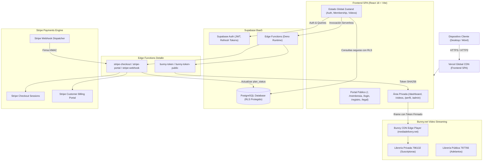
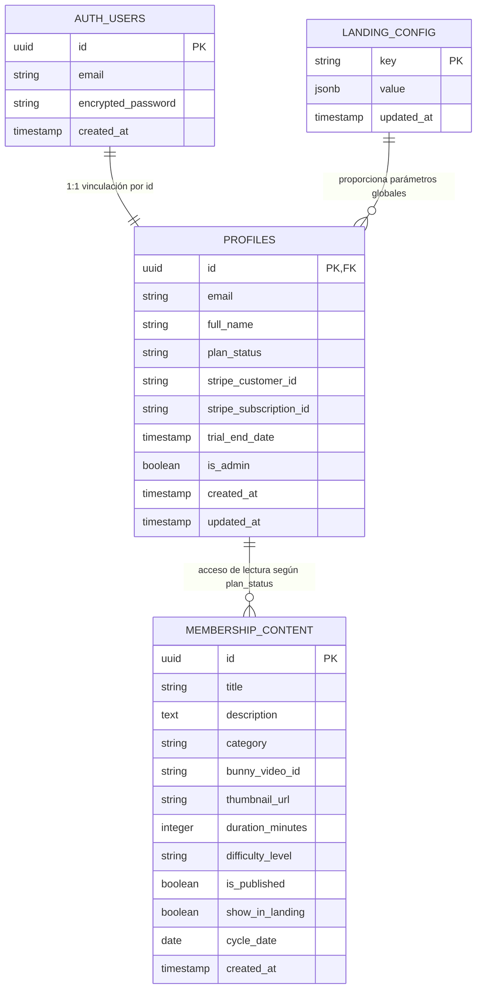
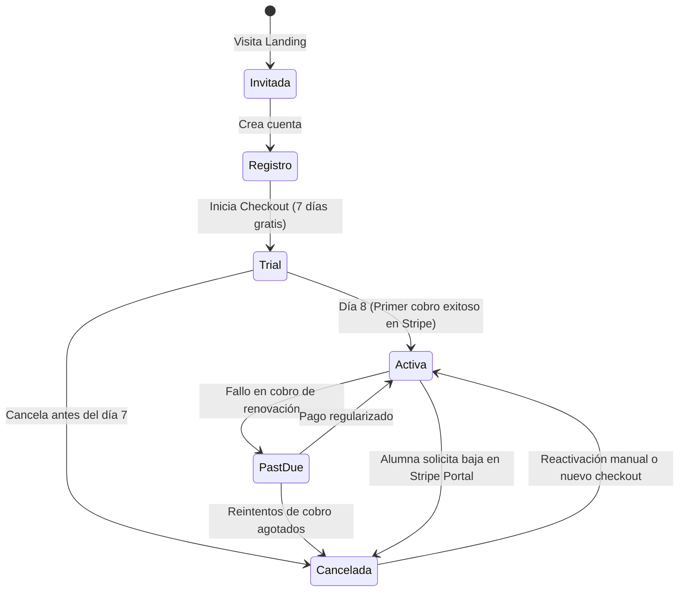

# Documento Técnico Integral de Arquitectura, Frontend, Backend y UX/UI — VIVIPRESSONFIT

**Plataforma Web de Entrenamiento, Membresía y Streaming de Video**  
*Versión del Sistema: 2.0.0 (Producción)*  
*Fecha de Consolidación: Noviembre 2026*  
*Entorno de Producción: [vivi-pressonfit.vercel.app](https://vivi-pressonfit.vercel.app/)*  

---

## Índice General

1. [Resumen Ejecutivo y Ficha Técnica](#1-resumen-ejecutivo-y-ficha-técnica)
2. [Arquitectura Global de la Solución](#2-arquitectura-global-de-la-solución)
3. [Capa Frontend (React 18 + TypeScript + Vite)](#3-capa-frontend-react-18--typescript--vite)
4. [Diseño de Interfaz, UX y Accesibilidad (WCAG 2.2 AA)](#4-diseño-de-interfaz-ux-y-accesibilidad-wcag-22-aa)
5. [Capa Backend, Datos y Persistencia (Supabase PostgreSQL)](#5-capa-backend-datos-y-persistencia-supabase-postgresql)
6. [Lógica Serverless (Supabase Edge Functions en Deno)](#6-lógica-serverless-supabase-edge-functions-en-deno)
7. [Streaming de Video Seguro (Bunny.net Stream)](#7-streaming-de-video-seguro-bunnynet-stream)
8. [Pasarela de Pagos y Suscripciones (Stripe)](#8-pasarela-de-pagos-y-suscripciones-stripe)
9. [Seguridad, Cabeceras y Resiliencia](#9-seguridad-cabeceras-y-resiliencia)
10. [Pipeline CI/CD, Despliegue y Operaciones](#10-pipeline-cicd-despliegue-y-operaciones)
11. [Glosario Técnico y Matriz de Responsabilidades](#11-glosario-técnico-y-matriz-de-responsabilidades)

---

## 1. Resumen Ejecutivo y Ficha Técnica

### 1.1 Propósito del Producto
**VIVIPRESSONFIT** es una plataforma SaaS de entrenamiento físico femenino bajo modelo de membresía por suscripción mensual recurrente. El producto combina:
* Portal público con adelantos gratuitos de clases, propuesta de valor cinematográfica y testimonios verificados.
* Flujo de conversión con periodo de prueba de 7 días gratuitos respaldado por Stripe.
* Portal privado exclusivo para suscriptoras activas con reproductor adaptativo de video de alta calidad, rutinas guiadas, recursos descargables y canal de comunidad.
* Panel de administración centralizado para control de contenidos, publicación de clases, moderación de miembros y edición modular de la landing page sin intervención de código.

### 1.2 Ficha Técnica del Stack

| Componente | Tecnología / Proveedor | Rol en la Plataforma |
| :--- | :--- | :--- |
| **Framework SPA** | React 18.3.1 + TypeScript 5.6.3 | Interfaz de usuario reactiva, modular y tipada estrictamente. |
| **Herramienta de Build** | Vite 7.3.7 + PostCSS + Autoprefixer | Empaquetado optimizado, HMR ultrarrápido y code-splitting. |
| **Estilos y Tokens** | Tailwind CSS 3.4.19 | Sistema de diseño atómico con tokens WCAG 2.2 contrastados. |
| **Enrutamiento** | React Router DOM 7.18.4 | Navegación del lado del cliente, rutas protegidas y deep-linking. |
| **Gestión de Estado** | Zustand 5.0.2 | Almacenes atómicos para autenticación, membresía y biblioteca de video. |
| **Scroll y Animación** | Lenis 1.3.27 | Desplazamiento inercial suave con soporte nativo de accesibilidad. |
| **BaaS / Database** | Supabase (PostgreSQL 15+) | Autenticación JWT, base de datos relacional y políticas RLS. |
| **Cómputo Serverless** | Supabase Edge Functions (Deno) | Generación de tokens HLS firmados y webhooks de pago Stripe. |
| **Infraestructura CDN/Hosting** | Vercel Edge Network | Hosting estático distribuido globalmente, SSL TLS 1.3 y CI/CD. |
| **CDN de Streaming** | Bunny.net Stream (Librerías 796132 / 797766) | Transcodificación HLS adaptativa y protección por token firmado SHA-256. |
| **Monetización** | Stripe Billing & Customer Portal | Suscripciones recurrentes, gestión de tarjetas y prueba de 7 días. |

---

## 2. Arquitectura Global de la Solución

La solución implementa el paradigma **Jamstack desacoplado** combinado con **Backend-as-a-Service (BaaS)** y microservicios serverless en el borde (*Edge*):



### 2.1 Principios Rectores de la Arquitectura
1. **Seguridad de Confianza Cero (*Zero-Trust*):** El frontend nunca almacena claves maestras ni secretos de API. Ni la clave de Stripe ni la clave de firmado de Bunny Stream llegan al navegador.
2. **Autorización en Múltiples Capas:**
   * **Capa 1 (Cliente):** `ProtectedRoute` y guardas de enrutamiento en React.
   * **Capa 2 (Base de Datos):** *Row Level Security (RLS)* en PostgreSQL, asegurando que un usuario solo pueda leer las clases si su perfil tiene membresía activa.
   * **Capa 3 (Video CDN):** Tokens criptográficos firmados por tiempo limitado (`TOKEN_TTL = 7200s`) generados en el backend serverless.
3. **Resiliencia Operativa:** Fallbacks declarativos para componentes de video, desconexión elegante ante fallos de red y manejo exhaustivo de estados vacíos y de carga.

---

## 3. Capa Frontend (React 18 + TypeScript + Vite)

### 3.1 Estructura del Código Fuente
El código del frontend reside en la carpeta `web/`:

```
web/
├── public/                     # Activos estáticos servidos sin procesar
│   ├── _redirects              # Regla SPA para Vercel / Netlify
│   ├── landing/                # Logos, portadas WebP, reels e imágenes
│   └── robots.txt, sitemap.xml # SEO y directivas de rastreo
├── src/
│   ├── components/
│   │   ├── admin/              # Panel administrativo modular
│   │   │   ├── ContentManager.tsx       # Gestión de clases y videos
│   │   │   ├── LandingConfigEditor.tsx  # Editor en vivo de la landing
│   │   │   ├── MediaBucketManager.tsx   # Explorador de archivos de Supabase
│   │   │   ├── MediaManager.tsx         # Asignación rápida de miniaturas
│   │   │   └── MembersManager.tsx       # Moderación de suscriptoras y roles
│   │   ├── auth/               # Formularios de autenticación
│   │   │   ├── LoginForm.tsx            # Login con 1-Click Tester y autocompletado
│   │   │   ├── RegisterForm.tsx         # Registro con medidor de password
│   │   │   └── ProtectedRoute.tsx       # Guarda de rutas con skeleton
│   │   ├── landing/            # Secciones públicas del portal
│   │   │   ├── Hero.tsx                 # Portada cinematográfica accesible
│   │   │   ├── FeatureCarousel.tsx      # Carrusel con botón de pausa WCAG
│   │   │   ├── FreeVideoModal.tsx       # Modal accesible para adelantos
│   │   │   ├── MetodoVideo.tsx          # Video institucional optimizado
│   │   │   ├── Testimonios.tsx          # Prueba social con descargos legales
│   │   │   └── AboutMe.tsx              # Biografía y galería accesible
│   │   ├── layout/             # Shell visual
│   │   │   ├── Navbar.tsx               # Barra sticky con menú móvil accesible
│   │   │   ├── Footer.tsx               # Pie con enlaces y selector de cookies
│   │   │   ├── Sidebar.tsx              # Navegación del área de miembros
│   │   │   └── Breadcrumbs.tsx          # Migajas de pan semánticas
│   │   ├── membership/         # Componentes de suscripción y facturación
│   │   │   ├── StatusCard.tsx           # Estado reactivo del plan y botón Stripe Portal
│   │   │   └── PlanCard.tsx             # Tarjeta de venta de membresía
│   │   ├── ui/                 # Primitivos del sistema de diseño
│   │   │   ├── Button.tsx               # Botón accesible (min-h: 44px, contraste AA)
│   │   │   ├── Input.tsx                # Entrada con aria-invalid y aria-describedby
│   │   │   ├── Modal.tsx                # Primitivo de diálogo con foco atrapado y Escape
│   │   │   ├── CookieBanner.tsx         # Consentimiento de cookies granular
│   │   │   ├── ErrorBoundary.tsx        # Captura de excepciones globales de render
│   │   │   └── Icons.tsx                # Familia de iconos SVG unificados
│   │   └── video/              # Reproductores multimedia
│   │       ├── VideoPlayer.tsx          # Reproductor seguro HLS de Bunny con reintento
│   │       ├── VideoCard.tsx            # Tarjeta de clase con badges de duración
│   │       └── VideoList.tsx            # Grilla con filtros por categoría
│   ├── hooks/                  # Hooks personalizados
│   │   ├── useAuth.ts          # Métodos de sesión y perfiles
│   │   ├── useLandingConfig.ts # Caché y proveedor de configuración global
│   │   └── useCarouselMedia.ts # Carga asíncrona de recursos multimedia
│   ├── lib/                    # Clientes y utilidades
│   │   ├── supabase.ts         # Instancia única de Supabase Client
│   │   ├── stripe.ts           # Inicialización de Stripe.js
│   │   ├── bunny.ts            # Consumo de Edge Functions de Bunny
│   │   ├── authErrors.ts       # Mapeo y traducción amigable de errores
│   │   └── offer.ts            # Fuente única de verdad de precios y trial
│   ├── pages/                  # Vistas principales vinculadas a rutas
│   │   ├── Home.tsx            # Landing page principal
│   │   ├── Membership.tsx      # Adquisición y suscripción
│   │   ├── Dashboard.tsx       # Inicio del área de miembros
│   │   ├── Videos.tsx          # Biblioteca de entrenamientos
│   │   ├── Profile.tsx         # Gestión de perfil y contraseña
│   │   ├── Admin.tsx           # Centro de control administrativo
│   │   └── NotFound.tsx        # Página 404 personalizada
│   ├── store/                  # Estado global Zustand
│   │   ├── authStore.ts        # Usuario, perfil y roles
│   │   ├── membershipStore.ts  # Estado del plan, trial y Stripe IDs
│   │   └── videoStore.ts       # Catálogo de clases y filtros
│   ├── types/                  # Definiciones de TypeScript
│   │   └── index.ts            # Modelos de datos compartidos
│   ├── router.tsx              # Configuración de React Router
│   ├── main.tsx                # Punto de entrada de la aplicación
│   └── index.css               # Directivas Tailwind y estilos base
├── eslint.config.cjs           # Configuración de linter estricto
├── tailwind.config.js          # Tokens de diseño y paleta cromática
├── tsconfig.json               # Configuración de TypeScript
└── vercel.json                 # Configuración de seguridad y rewrites para Vercel
```

### 3.2 Gestión del Estado Global (Zustand)
La aplicación descarta soluciones pesadas como Redux en favor de almacenes atómicos y desacoplados con **Zustand**:

1. **`authStore` (`src/store/authStore.ts`):**  
   Controla el ciclo de vida de la sesión de Supabase Auth. Mantiene el token JWT en memoria y sincroniza reactivamente el perfil del usuario (`profiles`). Ofrece un estado `initializing` que impide parpadeos (*flashes of unauthenticated state*) en rutas protegidas.
2. **`membershipStore` (`src/store/membershipStore.ts`):**  
   Centraliza el estado comercial de la usuaria: `plan_status` (`'trial' | 'active' | 'past_due' | 'canceled' | 'inactive'`), fecha de vencimiento del trial (`trial_end_date`), y claves foráneas de Stripe (`stripe_customer_id`, `stripe_subscription_id`).
3. **`videoStore` (`src/store/videoStore.ts`):**  
   Gestiona la lista de clases publicadas, asegurando mediante un mapeo estricto que las clases privadas de suscriptoras utilicen el ID canónico de Bunny Stream (`fec9d91b-cccc-4f1c-9729-2e91a53f33b4`) y filtrando cualquier contenido marcado exclusivamente como adelanto público.

---

## 4. Diseño de Interfaz, UX y Accesibilidad (WCAG 2.2 AA)

La aplicación fue sometida a una remediación integral de 24 hallazgos de diseño y accesibilidad (**F-01 a F-24**), certificando conformidad con el estándar internacional **WCAG 2.2 Nivel AA**.

### 4.1 Tokens de Diseño y Sistema Visual
Los tokens están definidos de forma centralizada en `web/tailwind.config.js` y `web/src/index.css`:

```javascript
// web/tailwind.config.js
module.exports = {
  theme: {
    extend: {
      colors: {
        background: '#080709',       // Fondo ultra oscuro de alto confort visual
        surface: '#131015',          // Tarjetas y paneles modales
        'surface-highlight': '#1D1920', // Estados hover y activos
        border: '#332836',           // Bordes de componentes con contraste 3:1
        accent: '#FF2E93',           // Rosa fucsia institucional de marca
        'accent-dark': '#E01B7D',    // Hover del acento
        'text-primary': '#FFFFFF',   // Texto principal sobre fondos oscuros
        'text-secondary': '#9E95A3', // Texto secundario (contraste > 6.5:1)
      },
      borderRadius: {
        pill: '9999px',              // Botones y badges en forma de píldora consistente
      }
    }
  }
}
```

### 4.2 Matriz de Contraste Cromatico Resuelto (WCAG 1.4.3 & 1.4.11)

| Elemento | Primer Plano | Fondo | Ratio de Contraste | Cumplimiento WCAG |
| :--- | :--- | :--- | :--- | :--- |
| **Texto de Botón Primario** | `#080709` *(Tinta oscura)* | `#FF2E93` *(Rosa acento)* | **5.80:1** | ✅ Cumple AA (mínimo 4.5:1) |
| **Texto Secundario** | `#9E95A3` *(Gris lavanda)* | `#080709` *(Fondo)* | **6.97:1** | ✅ Cumple AA (mínimo 4.5:1) |
| **Borde de Campos / Inputs** | `#332836` *(Gris borde)* | `#131015` *(Superficie)* | **3.05:1** | ✅ Cumple AA Componentes (1.4.11) |
| **Rosa como Texto** | `#FF2E93` *(Acento)* | `#080709` *(Fondo)* | **5.80:1** | ✅ Cumple AA para titulares |

### 4.3 Resoluciones Críticas de Accesibilidad Implementadas
* **Control de Movimiento (WCAG 2.2.2):** Todos los componentes con animación continua (`SwiperWrapper`, `FeatureCarousel`, `MetodoVideo`) cuentan con:
  * Botones explícitos y visibles de **Pausa / Reanudar** con atributos `aria-pressed`.
  * Pausa automática inmediata al recibir foco de teclado (`:focus-within`) o puntero del ratón (`:hover`).
  * Desactivación total de transiciones y movimientos automáticos bajo la directiva del sistema operativo `@media (prefers-reduced-motion: reduce)`.
* **Primitivo de Diálogo y Modales (WCAG 2.1.1, 2.4.3):**  
  Implementado en `web/src/components/ui/Modal.tsx`. Al abrirse un modal:
  1. Se bloquea el desplazamiento del fondo (`overflow: hidden` en `body`).
  2. Se atrapa el foco del teclado dentro del diálogo (imposibilitando saltar a elementos subyacentes).
  3. Se habilita el cierre mediante la tecla `Escape` o clic en el backdrop.
  4. Al cerrarse, el foco se restaura automáticamente al botón que originó la apertura.
* **Encabezados Semánticos (WCAG 1.3.1, 2.4.6):**  
  Se garantiza la existencia de un único encabezado `<h1>` semántico por página, visible de forma consistente tanto en pantallas móviles como de escritorio (`Hero.tsx`).
* **Metas Táctiles (WCAG 2.5.5 / 2.5.8):**  
  Todos los botones interactivos, enlaces de navegación, toggles de reproducción y botones de cierre poseen dimensiones mínimas garantizadas de **44 x 44 px**.

---

## 5. Capa Backend, Datos y Persistencia (Supabase PostgreSQL)

El backend aprovecha la potencia de PostgreSQL sobre Supabase, implementando un esquema relacional normalizado con control de acceso basado en políticas (*Row Level Security*).

### 5.1 Diagrama Entidad-Relación (ERD)



### 5.2 Políticas de Seguridad de Fila (RLS)
La base de datos protege el contenido exclusivo para suscriptoras a nivel de motor SQL:

```sql
-- Habilitar RLS en la tabla de contenidos
ALTER TABLE public.membership_content ENABLE ROW LEVEL SECURITY;

-- 1. Acceso público a videos promocionales de la landing
CREATE POLICY "Public Teaser Videos Access"
ON public.membership_content
FOR SELECT
USING (
  is_published = true AND show_in_landing = true
);

-- 2. Acceso exclusivo para miembros y administradoras
CREATE POLICY "Active Subscribers Exclusive Access"
ON public.membership_content
FOR SELECT
TO authenticated
USING (
  is_published = true AND (
    EXISTS (
      SELECT 1 FROM public.profiles
      WHERE profiles.id = auth.uid()
      AND (
        profiles.is_admin = true
        OR profiles.plan_status = 'active'
        OR profiles.plan_status = 'past_due'
        OR (
          profiles.plan_status = 'trial' 
          AND profiles.trial_end_date > now()
        )
      )
    )
  )
);
```

### 5.3 Asignación Atómica de Cuentas Tester (`claim_next_test_account`)
Para facilitar pruebas continuas sin colisiones entre desarrolladores y testers, la base de datos dispone de una función RPC atómica (`web/supabase/claim_next_test_account.sql`):
* Incrementa un contador atómico en `landing_config`.
* Devuelve correlativamente `miembro01@test.vivipressonfit.com` hasta `miembro30`.
* Si el usuario no existe, lo crea dinámicamente en `auth.users` y le asigna `plan_status = 'active'` en `profiles` con contraseña predefinida `TestVivi2026!`.

---

## 6. Lógica Serverless (Supabase Edge Functions en Deno)

Ubicadas en `web/supabase/functions/`, estas funciones ejecutan lógica crítica fuera del alcance del navegador.

### 6.1 `bunny-token`
* **Ruta:** `POST /functions/v1/bunny-token`
* **Entrada:** `{ "videoId": "guid-del-video" }` con cabecera `Authorization: Bearer <jwt_supabase>`.
* **Proceso:**
  1. Valida el JWT y obtiene el usuario mediante `supabase.auth.getUser()`.
  2. Consulta la tabla `profiles` para verificar que la usuaria sea administradora, tenga `plan_status = 'active'` o un `trial` vigente. Si no cumple, rechaza con **`HTTP 403 Forbidden`**.
  3. Lee los secretos del entorno (`BUNNY_STREAM_TOKEN_KEY`, `BUNNY_INTEGRATION_ID`).
  4. Genera un token SHA-256 válido por 2 horas (7200 segundos):
     $$\text{Token} = \text{SHA256\_HEX}(\text{BUNNY\_STREAM\_TOKEN\_KEY} + \text{videoId} + \text{expires})$$
  5. Retorna `{ embedUrl, hlsUrl, expiresAt }`.

### 6.2 `bunny-token-public`
* **Ruta:** `POST /functions/v1/bunny-token-public`
* **Entrada:** `{ "videoId": "guid-del-video" }` sin requerir autenticación.
* **Proceso:** Comprueba mediante una lista blanca (*allowlist*) en `landing_config` o `membership_content (show_in_landing = true)` que el video esté explícitamente autorizado como público antes de emitir el token de visualización.

### 6.3 `stripe-checkout` & `stripe-portal`
* **`stripe-checkout`:** Crea una sesión de Stripe Checkout configurando `trial_period_days: 7`, modalidad `subscription`, y metadatos con el `userId` para reconciliación en webhooks.
* **`stripe-portal`:** Genera un enlace de sesión temporal hacia el Portal del Cliente de Stripe, permitiendo a la alumna actualizar su tarjeta de crédito o cancelar la suscripción de forma autónoma.

### 6.4 `stripe-webhook`
* **Ruta:** `POST /functions/v1/stripe-webhook`
* **Proceso:**
  1. Verifica la firma criptográfica HMAC en la cabecera `stripe-signature` usando `STRIPE_WEBHOOK_SIGNING_SECRET`.
  2. Procesa eventos clave:
     * `customer.subscription.created` → Asigna `plan_status = 'trial'` o `'active'`.
     * `customer.subscription.updated` → Actualiza el estado a `'active'`, `'past_due'` o `'canceled'`.
     * `customer.subscription.deleted` → Degrada el estado a `'canceled'`.
     * `invoice.payment_succeeded` → Renueva el ciclo mensual y confirma `'active'`.
     * `invoice.payment_failed` → Marca el plan como `'past_due'`.

---

## 7. Streaming de Video Seguro (Bunny.net Stream)

### 7.1 Distribución y Librerías
La arquitectura divide el catálogo en dos librerías para prevenir cualquier fuga de propiedad intelectual:

| Librería Bunny | ID | Propósito | Reglas de Acceso |
| :--- | :--- | :--- | :--- |
| **Librería Pública** | `797766` | Adelantos gratis, reels de hero y carrusel de comunidad. | Reproducción directa en `iframe.mediadelivery.net`. |
| **Librería Privada** | `796132` | Clases completas del portal de miembros (Full Body, GAP, Cardio). | **Token Authentication obligatorio**. Bloqueo de direct play. Solo responde con token SHA-256 emitido por `bunny-token`. |

### 7.2 Implementación del Reproductor (`VideoPlayer.tsx`)
El reproductor en `web/src/components/video/VideoPlayer.tsx` implementa un ciclo de vida robusto:
1. Solicita el token firmado mediante `requestBunnyToken(videoId)`.
2. Si el usuario no tiene membresía, captura la excepción y presenta una pantalla de alerta comprensible con botón de reintento.
3. Incrusta el reproductor profesional responsivo:
   `https://iframe.mediadelivery.net/embed/796132/<guid>?token=<hash>&expires=<timestamp>&autoplay=false&preload=true&responsive=true`
4. Soporta transcodificación HLS adaptativa (1080p, 720p, 480p, 360p) ajustándose a la velocidad de conexión del usuario.

---

## 8. Pasarela de Pagos y Suscripciones (Stripe)

### 8.1 Oferta y Modelo de Suscripción
* **Precio Estándar:** USD 40,00 / mes (sincronizado dinámicamente mediante `src/lib/offer.ts`).
* **Periodo de Prueba (*Trial*):** 7 días de acceso irrestricto sin cargo inicial.
* **Transparencia en Facturación:** Durante el checkout se comunica de forma explícita el importe inicial ($0,00 hoy), la fecha exacta del primer cobro y la posibilidad de cancelar en cualquier momento con un clic.

### 8.2 Ciclo de Vida de la Suscripción



---

## 9. Seguridad, Cabeceras y Resiliencia

### 9.1 Cabeceras de Seguridad HTTP en Vercel
Definidas en `web/vercel.json` para mitigar ataques XSS, Clickjacking e inyección:

```json
{
  "headers": [
    {
      "source": "/(.*)",
      "headers": [
        { "key": "X-Content-Type-Options", "value": "nosniff" },
        { "key": "X-Frame-Options", "value": "SAMEORIGIN" },
        { "key": "Referrer-Policy", "value": "strict-origin-when-cross-origin" },
        { "key": "Permissions-Policy", "value": "camera=(), microphone=(), geolocation=()" }
      ]
    },
    {
      "source": "/assets/(.*)",
      "headers": [
        { "key": "Cache-Control", "value": "public, max-age=31536000, immutable" }
      ]
    }
  ]
}
```

### 9.2 Resiliencia de la Aplicación
* **`ErrorBoundary` Global:** Ubicado en la raíz de `src/App.tsx`, captura cualquier error de renderizado en React, evitando la pantalla en blanco y ofreciendo una interfaz de recuperación con recarga controlada.
* **Sanitización y Validación:**
  * Formulario de registro con validación interactiva de fortaleza de contraseña (`PasswordStrength.tsx`) y detección de Bloqueo de Mayúsculas (*Caps Lock*).
  * Catálogo centralizado de errores en español en `src/lib/authErrors.ts` que traduce excepciones crudas del backend a mensajes amigables y orientados a la acción.

---

## 10. Pipeline CI/CD, Despliegue y Operaciones

### 10.1 Pipeline Automatizado de GitHub Actions
Ubicado en `.github/workflows/ci.yml`. Se ejecuta en cada `push` o `pull_request` sobre la rama `main`:

```yaml
name: CI
on:
  push:
    branches: [ main ]
  pull_request:
    branches: [ main ]

jobs:
  validate:
    name: Lint, Typecheck & Build
    runs-on: ubuntu-latest
    defaults:
      run:
        working-directory: web
    steps:
      - uses: actions/checkout@v4
      - uses: actions/setup-node@v4
        with:
          node-version: 22
          cache: 'npm'
          cache-dependency-path: web/package-lock.json
      - run: npm ci
      - run: npm run lint
      - run: npm run typecheck
      - run: npm run build
```

### 10.2 Despliegue en Vercel y Gestión de URLs
Vercel está conectado directamente al repositorio de GitHub:
1. **Despliegue de Producción Oficial:**  
   Cada commit validado en `main` se publica inmediatamente en el dominio canónico:  
   👉 **`https://vivi-pressonfit.vercel.app/`**
2. **URLs Técnicas de Soporte (Inmutables):**  
   * **Branch Alias:** `vivi-pressonfit-git-main-vivipressonfitness.vercel.app` (apunta siempre a la punta de la rama).
   * **Deployment Hash:** `vivi-pressonfit-<hash>-vivipressonfitness.vercel.app` (instantánea inmutable del commit para auditorías y rollbacks instantáneos).

---

## 11. Glosario Técnico y Matriz de Responsabilidades

| Concepto | Definición Técnica en el Proyecto |
| :--- | :--- |
| **RLS (Row Level Security)** | Mecanismo de PostgreSQL que evalúa en tiempo de consulta si el usuario autenticado tiene derecho a ver una fila específica de `membership_content`. |
| **Token Authentication (Bunny)** | Firma criptográfica SHA-256 compuesta por clave secreta + ID de video + timestamp de expiración que autoriza la visualización de un video privado. |
| **BaaS (Backend-as-a-Service)** | Arquitectura donde la autenticación, base de datos y almacenamiento de archivos son gestionados por Supabase. |
| **WCAG 2.2 AA** | Pauta internacional de accesibilidad web que garantiza que personas con discapacidades visuales, auditivas, motoras o cognitivas puedan operar la plataforma. |
| **Reduced Motion** | Consulta de medios CSS (`prefers-reduced-motion`) que detiene animaciones y transiciones continuas para usuarias con trastornos vestibulares. |
| **HMAC Signature** | Código de autenticación de mensajes basado en hash que utiliza Stripe en sus webhooks para asegurar que las notificaciones no han sido interceptadas ni falseadas. |

---

*Documento Técnico Consolidado · Plataforma VIVIPRESSONFIT · Noviembre 2026 · Aprobado para operación y mantenimiento.*
