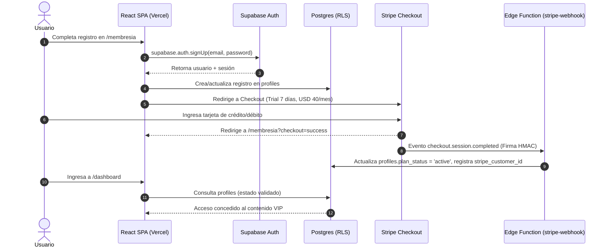

# Manual de Operaciones, Arquitectura y Handover — VIVIPRESSONFIT

> **Versión del Sistema:** 2.0.0 (Producción)  
> **Fecha de Documentación:** Octubre 2026  
> **Objetivo:** Guía operativa, técnica y de transferencia completa para el mantenimiento, despliegue y soporte continuo de la plataforma VIVIPRESSONFIT.

---

## 1. Arquitectura General del Sistema (DOC-01)

VIVIPRESSONFIT está estructurado bajo una arquitectura moderna desacoplada (Jamstack + Backend-as-a-Service), garantizando alta disponibilidad, seguridad estricta y costos operativos mínimos.

### 1.1 Diagrama de Componentes

```mermaid
flowchart TD
    User["Usuario / Navegador (Desktop / Móvil)"] -->|HTTPS / CDN Global| Vercel["Vercel Edge Network (Frontend SPA React + Vite)"]
    
    subgraph Frontend["Frontend Layer (React 18 + TS + Tailwind)"]
        Vercel --> PublicRoutes["Rutas Públicas (/, /membresia, /login, /legal)"]
        Vercel --> ProtectedRoutes["Rutas Privadas (/dashboard, /videos, /admin, /perfil)"]
    end

    subgraph SupabasePlatform["Supabase Platform (BaaS)"]
        PublicRoutes -->|Auth / Anon Key| SupabaseAuth["Supabase Auth (JWT & Sesiones)"]
        ProtectedRoutes -->|JWT Autenticado + RLS| SupabaseDB[("PostgreSQL Database (profiles, content, config)")]
        ProtectedRoutes -->|Storage Privado| SupabaseStorage["Supabase Storage (PDFs y Guías Privadas)"]
        
        subgraph EdgeFunctions["Supabase Edge Functions (Deno Runtime)"]
            EF_StripeCheckout["stripe-checkout"]
            EF_StripePortal["stripe-portal"]
            EF_StripeWebhook["stripe-webhook"]
            EF_BunnyToken["bunny-token"]
        end
    end

    subgraph StripeService["Pasarela de Pagos (Stripe)"]
        EF_StripeCheckout -->|Crear Sesión Checkout| StripeAPI["Stripe API (Suscripción + 7 Días Trial)"]
        EF_StripePortal -->|Crear Sesión Billing| StripePortal["Stripe Customer Portal"]
        StripeAPI -->|Webhook Events (HMAC)| EF_StripeWebhook
        EF_StripeWebhook -->|Actualizar Status de Plan| SupabaseDB
    end

    subgraph VideoStreaming["Streaming de Video (Bunny Stream)"]
        ProtectedRoutes -->|Solicitar Token Firmado| EF_BunnyToken
        EF_BunnyToken -->|Genera Token SHA256| ProtectedRoutes
        ProtectedRoutes -->|HLS Player con Token| BunnyCDN["Bunny Stream CDN (HLS Seguro)"]
    end
```

### 1.2 Flujo de Datos y Autenticación



---

## 2. Variables de Entorno y Configuración (DOC-02, DEP-09)

### 2.1 Frontend (`web/.env` y Vercel Environment Variables)

Todas las variables que utiliza Vite en el cliente deben comenzar con el prefijo `VITE_`. **Ninguna de estas variables es secreta** ya que se compilan en el bundle descargado por los usuarios.

| Variable | Tipo | Propósito | Ejemplo / Formato |
|---|---|---|---|
| `VITE_SUPABASE_URL` | Público | URL base del proyecto en Supabase | `https://xxxx.supabase.co` |
| `VITE_SUPABASE_ANON_KEY` | Público | Clave anónima pública de Supabase | `eyJhbGciOi...` |
| `VITE_STRIPE_PUBLISHABLE_KEY` | Público | Clave publicable de Stripe | `pk_live_...` / `pk_test_...` |
| `VITE_WHATSAPP_NUMBER` | Público | Número oficial de soporte (E.164 sin signos) | `5493415888117` |

### 2.2 Backend (`web/supabase/.env` y Supabase Edge Secrets)

Estas claves son estrictamente confidenciales y deben configurarse únicamente en el entorno de ejecución de las Edge Functions (`supabase secrets set`).

| Variable Secreta | Propósito | Nivel de Riesgo |
|---|---|---|
| `SUPABASE_SERVICE_ROLE_KEY` | Clave administrativa de Postgres (bypasea RLS en webhooks) | **Crítico** |
| `STRIPE_SECRET_KEY` | Clave secreta de Stripe para invocar la API de cobros | **Crítico** |
| `STRIPE_PRICE_ID` | Identificador de precio recurrente mensual en Stripe | Medio |
| `STRIPE_WEBHOOK_SECRET` | Secreto para verificación de firmas de webhook (`whsec_...`) | **Crítico** |
| `APP_ORIGIN` | Dominios autorizados para retorno y CORS | Medio |
| `BUNNY_STREAM_API_KEY` | Clave de gestión de la librería de video Bunny Stream | Alto |
| `BUNNY_STREAM_TOKEN_KEY` | Clave simétrica para firmado SHA-256 de URLs HLS | **Crítico** |
| `BUNNY_STREAM_LIBRARY_ID` | ID de la biblioteca de medios en Bunny | Bajo |

---

## 3. Modelo de Datos y Políticas de Seguridad RLS (DOC-03)

### 3.1 Tablas Principales

1. **`profiles`**:
   - `id` (UUID, PK, FK a `auth.users.id` con `ON DELETE CASCADE`)
   - `email` (Text, unique)
   - `role` (Text: `'admin'` o `'member'`)
   - `plan_status` (Text: `'trial'`, `'active'`, `'past_due'`, `'canceled'`, `'inactive'`)
   - `stripe_customer_id` (Text, nullable)
   - `stripe_subscription_id` (Text, nullable)
   - `created_at`, `updated_at` (Timestamptz)

2. **`membership_content`**:
   - `id` (UUID, PK)
   - `title`, `description` (Text)
   - `category` (Text: `'clases'`, `'rutinas'`, `'nutricion'`, `'guias'`)
   - `video_id` (Text, ID del video en Bunny Stream)
   - `pdf_url` (Text, ruta en el bucket de storage)
   - `thumbnail_url` (Text)
   - `duration`, `difficulty`, `target` (Metadatos)
   - `access_level` (Text: `'public'`, `'trial'`, `'member'`)
   - `published` (Boolean)

3. **`landing_config`**:
   - `key` (Text, PK: `'hero_texts'`, `'whatsapp_number'`, `'monthly_price'`, etc.)
   - `value` (Text / JSON)
   - `updated_at` (Timestamptz)

### 3.2 Matriz de Row Level Security (RLS)

| Tabla | Operación | Rol Anónimo | Rol Miembro | Rol Admin |
|---|---|---|---|---|
| `profiles` | SELECT | Denegado | Solo su propio registro (`id = auth.uid()`) | Todos los registros |
| `profiles` | UPDATE | Denegado | Solo campos no sensibles propios | Todos los registros |
| `membership_content` | SELECT | Solo si `published = true AND access_level = 'public'` | Solo si `published = true AND plan_status IN ('active', 'trial')` | Todos los registros (incluye borradores) |
| `membership_content` | INSERT / UPDATE / DELETE | Denegado | Denegado | Permitido |
| `landing_config` | SELECT | Permitido (lectura pública) | Permitido | Permitido |
| `landing_config` | UPDATE | Denegado | Denegado | Permitido |

---

## 4. Configuración y Operación de Stripe (DOC-04, PAY-01..16)

### 4.1 Definición Comercial
- **Precio mensual:** USD 40.00 / mes (recurrente).
- **Período de prueba:** 7 días de acceso completo sin cargo inicial.
- **Requisito de tarjeta:** Se requiere tarjeta válida al momento de iniciar el trial para prevenir abusos y automatizar la transición al día 8.
- **Cancelación:** Sin permanencia; ejecutable en cualquier momento desde el Customer Portal.

### 4.2 Webhooks Configurables en Stripe Dashboard
En el panel de Stripe (Modo Producción o Test), configurar el endpoint:
- **URL del Endpoint:** `https://<TU-PROYECTO-SUPABASE>.supabase.co/functions/v1/stripe-webhook`
- **Eventos a escuchar:**
  - `checkout.session.completed` (Alta de nueva suscripción con trial)
  - `customer.subscription.updated` (Cambio de plan o renovación)
  - `customer.subscription.deleted` (Cancelación de suscripción)
  - `invoice.payment_succeeded` (Renovación mensual cobrada exitosamente)
  - `invoice.payment_failed` (Fallo en cobro de tarjeta, pasa a `past_due`)

---

## 5. Streaming de Video con Bunny Stream (DOC-05)

### 5.1 Arquitectura de Protección
Para evitar descargas no autorizadas y distribución indebida de las clases de Vivi Presson:
1. Las clases no se sirven como archivos `.mp4` planos.
2. Se procesan en Bunny Stream generando un manifiesto dinámico HLS (`playlist.m3u8`).
3. El frontend solicita un token firmado a la Edge Function `bunny-token`, enviando el JWT de sesión.
4. La Edge Function valida que el usuario posea un perfil con `plan_status IN ('active', 'trial')` o `role = 'admin'`.
5. Si es válido, genera un hash SHA-256 firmado con expiración fija (2 horas).
6. El reproductor HLS consume los segmentos encriptados sin exponer la clave maestra.

---

## 6. Manual del Administrador (DOC-06, DOC-07)

### 6.1 Acceso al Panel de Administración
- Ruta: `/admin`
- Requisito: Iniciar sesión con un usuario que tenga `role = 'admin'` en la tabla `profiles`.
- Si un usuario no administrador intenta entrar, es redirigido automáticamente a `/dashboard`.

### 6.2 Funcionalidades Disponibles
1. **Pestaña "Contenido"**:
   - Crear, editar, publicar y despublicar clases, rutinas o guías de nutrición.
   - Subir portadas y asignar niveles de acceso (`público`, `trial`, `miembro`).
2. **Pestaña "Miembros"**:
   - Buscador de miembros en tiempo real (por nombre o correo).
   - Visualización del estado de cuenta (`trial`, `active`, `past_due`, `canceled`).
   - Gestión de privilegios con diálogo de confirmación de seguridad para evitar despromociones accidentales.
3. **Pestaña "Configuración Landing"**:
   - Modificación visual de títulos, subtítulos, precio mensual publicado y número de WhatsApp de soporte.
4. **Pestaña "Biblioteca de Archivos"**:
   - Carga y visualización de recursos descargables (PDFs, fichas de seguimiento).

---

## 7. Runbook de Incidentes y Resolución de Problemas (DOC-08, DEP-06)

| Incidente / Síntoma | Causa Frecuente | Protocolo de Resolución Inmediata |
|---|---|---|
| **Usuario pagó pero su cuenta sigue en estado "inactive"** | El webhook de Stripe falló, tuvo un timeout o la firma `STRIPE_WEBHOOK_SECRET` no coincide. | 1. Ir a Stripe Dashboard → Developers → Webhooks → Seleccionar evento fallido.<br>2. Ver respuesta HTTP devuelta.<br>3. Hacer clic en "Resend Event".<br>4. Si persiste, en Supabase Studio buscar en `profiles` por email y actualizar manualmente `plan_status = 'active'` y `stripe_customer_id`. |
| **Error "Firma de Stripe inválida" en logs de función** | Se rotó la clave del webhook en Stripe pero no se actualizó el secreto en Supabase. | Ejecutar: `supabase secrets set STRIPE_WEBHOOK_SECRET=whsec_nuevo`. |
| **Los videos HLS muestran pantalla negra o error 403** | Token expirado, clave de firmado desfasada o video en estado "Processing" en Bunny. | 1. Verificar en Bunny Stream que el video haya finalizado la transcodificación.<br>2. Confirmar que `BUNNY_STREAM_TOKEN_KEY` en Supabase coincida con el Token Authentication Key de la biblioteca en Bunny.<br>3. Verificar en Network del navegador que la petición a `bunny-token` retorne HTTP 200 con `{ token: "..." }`. |
| **Bucle de redirección en `/dashboard` hacia `/membresia`** | Race condition en la carga del perfil o sesión con `plan_status` en null. | El issue fue resuelto en la Fase 07 (espera de `loadProfile` previa a `initializing = false`). Si ocurre por datos corruptos, revisar la fila del usuario en `profiles` y asegurarse de que tenga `plan_status` definido. |
| **Fallo en despliegue de Vercel** | Error de compilación TypeScript o fallo en ESLint. | Ejecutar localmente `npm run lint` y `npm run typecheck` en la carpeta `web`. Revisar la pestaña "Deployments" en Vercel para ver el log de compilación. |

---

## 8. Estrategia de Respaldo y Recuperación (DEP-04)

- **Base de Datos (Supabase):**
  - Supabase Pro / Team realiza copias de seguridad diarias automatizadas con Point-In-Time Recovery (PITR).
  - Para respaldos manuales puntuales antes de cambios de esquema:
    ```bash
    supabase db dump -f backup_$(date +%Y%m%d).sql
    ```
- **Almacenamiento de Archivos:**
  - Los archivos de `members-media` y `landing` residen en Supabase Storage con redundancia geográfica nativa.
- **Código Fuente y Configuración:**
  - El repositorio Git en GitHub contiene el 100% de la lógica de frontend, migraciones SQL (`web/supabase/`) y funciones Edge.

---

## 9. Lista de Entrega y Credenciales Requeridas para Handover (DOC-09)

Para la transferencia definitiva al cliente o equipo de mantenimiento:

- [ ] **Vercel:** Acceso con rol de Administrador o transferencia del proyecto `vivi-pressonfit` a la cuenta corporativa.
- [ ] **Supabase:** Transferencia de la organización o invitación como Owner del proyecto.
- [ ] **Stripe:** Acceso al Dashboard de Stripe en modo Live para gestión de pagos, facturación y reembolsos.
- [ ] **Bunny.net:** Credenciales de la cuenta que aloja la biblioteca de video Bunny Stream.
- [ ] **Registrador de Dominio (DNS):** Acceso para gestión de registros `A` y `CNAME` (`vivipressonfit.com`).
- [ ] **WhatsApp Business:** Confirmación del número oficial asociado a la línea de atención al cliente.

---

## 10. Changelog y Resumen de Fases (DOC-10)

- **Fase 01 a 04:** Estructura modular base, autenticación Supabase, catálogo de videos y checkout Stripe.
- **Fase 05:** Dominio canónico, metadatos SEO, OpenGraph, JSON-LD estructurado, sitemap y resolución de findings críticos F-01 a F-04.
- **Fase 06:** Accesibilidad integral WCAG 2.2 AA (pausa de movimiento, focus trap en modales, diálogo `FreeVideoModal`, touch targets de 44px, optimización de assets).
- **Fase 07:** Resiliencia de autenticación (eliminación de race conditions en `authStore`), diccionario de traducción de errores de Supabase Auth, salvaguardas en panel admin y marco legal del trial.
- **Fase 08:** Integración continua CI/CD con GitHub Actions, plantillas de variables de entorno seguras (`.env.example`), manual operativo y documentación de arquitectura y handover.

