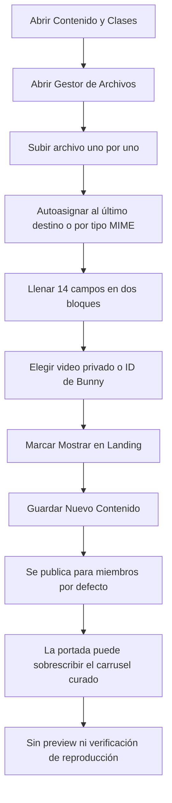
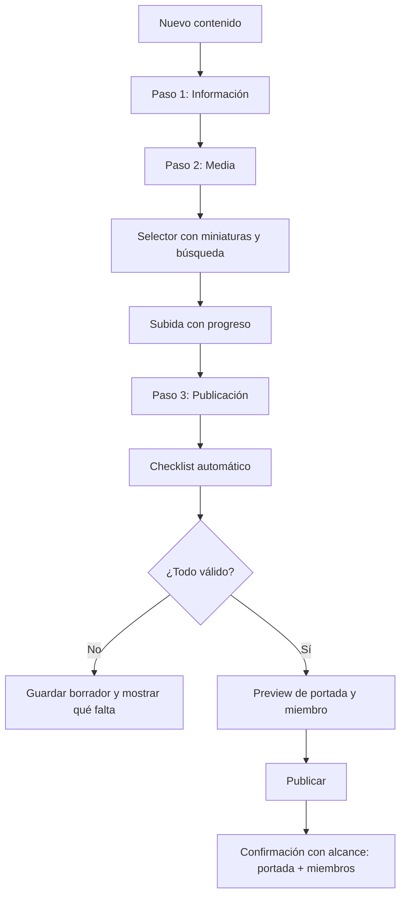

# Auditoría técnica — Flujo de carga y publicación de "Contenido y Clases"

**Panel de administración · Carga de contenido · Publicación**

> El módulo no falla por falta de funciones: falla porque está diseñado como un formulario de base de datos y no como una herramienta de publicación. Este documento traza el recorrido completo del contenido —desde la subida del archivo hasta lo que ve una visitante y una alumna— y propone un flujo verificable, seguro y predecible.

| Campo | Valor |
| --- | --- |
| Fecha | 1 de noviembre de 2026 |
| Alcance | Pestaña `Contenido y Clases` y su cadena de publicación (admin → storage → landing → área de miembros) |
| Archivos revisados | `ContentManager.tsx` (875 líneas), `MediaBucketManager.tsx` (271), `MediaManager.tsx` (127), `storage.ts` (131), `Admin.tsx` (131), `useLandingConfig.ts`, `bunny-token-public`, RLS, tipos y esquema |
| Método | Revisión estática de código y trazado del dato hasta sus consumidores |
| Hallazgos | 20 — 4 críticos, 10 altos, 6 medios |
| Cambios en el código | **Ninguno** |
| Referencia | Auditoría UI/UX previa (`informe-auditoria-ui-ux-vivipressonfit.md`, sección 11) |

> Este documento no modifica la aplicación. Es un diagnóstico técnico y una propuesta de rediseño del flujo; no una certificación de calidad ni un sustituto de pruebas con usuarios reales.

---

## Índice

1. [Resumen ejecutivo](#01--resumen-ejecutivo)
2. [Alcance y método](#02--alcance-y-método)
3. [Flujo actual](#03--flujo-actual)
4. [Hallazgos priorizados](#04--hallazgos-priorizados)
5. [Propuesta de flujo objetivo](#05--propuesta-de-flujo-objetivo)
6. [Checklist de publicación](#06--checklist-de-publicación)
7. [Cambios de modelo de datos](#07--cambios-de-modelo-de-datos)
8. [Accesibilidad y microcopy](#08--accesibilidad-y-microcopy)
9. [Plan de implementación](#09--plan-de-implementación)
10. [Métricas de validación](#10--métricas-de-validación)
11. [Decisiones de producto pendientes](#11--decisiones-de-producto-pendientes)
12. [Anexos](#12--anexos)

---

## 01 · Resumen ejecutivo

El panel permite cargar contenido, pero no permite **publicarlo con confianza**. El administrador captura catorce campos visibles, abre un gestor de archivos en otra zona de la página y guarda, sin saber qué verá una visitante, qué verá una alumna ni si el video va a reproducirse.

Tres conclusiones ordenan el diagnóstico:

1. **Publicar es peligroso.** Un único checkbox (`show_in_landing`) puede dejar la clase completa accesible en la portada pública, con token firmado y sin ninguna advertencia. No es una hipótesis: está en el código y se produce por cuatro caminos distintos.
2. **La publicación es ambigua.** Existen dos booleanos independientes (`is_published`, `show_in_landing`), cuatro combinaciones posibles y ningún estado derivado visible. El formulario crea contenido **publicado por defecto** y un borrador puede aparecer en la portada.
3. **Cargar contenido es lento y a ciegas.** La biblioteca no tiene miniaturas ni búsqueda, los archivos llegan con prefijo de timestamp, la subida no muestra progreso y el selector abre un cajón al principio de la página que, en un formulario largo, queda fuera de vista.

### Cifras del diagnóstico

| Indicador | Valor | Lectura |
| --- | --- | --- |
| Líneas del componente principal | **875** | Un formulario, un listado, un cajón de archivos y un modal en un solo archivo |
| Campos del formulario | **14 visibles / 17 en el payload** | Sin secciones, pasos ni guardado progresivo |
| Booleanos de publicación | **2** | Cuatro estados posibles sin nombre ni regla visible |
| Fuentes de verdad del carrusel | **2** | `membership_content` y `landing_config` compiten en silencio |
| Peticiones para listar la biblioteca | **5** | Una por carpeta, secuenciales, sin paginación |
| Campos del payload sin interfaz | **3** | `storage_path`, `content_url`, `class_type` |

### Veredicto de usabilidad del flujo: 4,5 / 10

Funciona técnicamente. Pero exige memoria, ensayo y error, y permite errores con consecuencias públicas. La nota es un juicio profesional para priorizar, no una métrica estadística.

### Riesgo si no se corrige

- Una clase de pago puede quedar pública con un clic.
- Una clase publicada puede no reproducirse y descubrirse recién con una alumna.
- La selección curada del carrusel puede desaparecer sin que nadie lo note.
- Cada ciclo mensual obliga a repetir el mismo trabajo manual, con riesgo de duplicados y archivos huérfanos.

---

## 02 · Alcance y método

### Qué se revisó

| Superficie | Archivos | Qué se analizó |
| --- | --- | --- |
| Captura de contenido | `components/admin/ContentManager.tsx` | Formulario, defaults, validaciones, toggles, listado, modal de borrado |
| Biblioteca de archivos | `components/admin/MediaBucketManager.tsx`, `lib/storage.ts` | Subida, asignación, listado, borrado, URLs |
| Pestaña de medios | `components/admin/MediaManager.tsx` | Segunda entrada al mismo gestor |
| Navegación del panel | `pages/Admin.tsx` | Montaje/desmontaje de pestañas y carga de datos |
| Consumo público | `hooks/useLandingConfig.ts`, `components/landing/Sections.tsx` | Cómo llega el contenido a la portada y cómo se reproduce |
| Consumo privado | `pages/Videos.tsx`, `components/video/VideoPlayer.tsx` | Cómo se reproduce el contenido para miembros |
| Autorización y datos | `supabase/schema.sql`, `supabase/members_media_setup.sql`, `bunny-token-public` | RLS, bucket, tokens públicos |
| Tipos | `types/index.ts` | Contrato del modelo |

### Qué no se revisó

- Pruebas en navegador, con lector de pantalla o con datos de producción.
- Rendimiento medido en campo (solo se infiere del código).
- Configuración real de Supabase, Bunny Stream y políticas desplegadas.
- Aspectos de facturación o de autenticación ajenos a este flujo.

### Transparencia

Las referencias `archivo:línea` corresponden al estado actual del repositorio. Las propuestas son de diseño y no se implementaron.

---

## 03 · Flujo actual



### Recorrido real, paso a paso

| Paso | Qué hace el administrador | Qué responde el sistema | Fricción |
| --- | --- | --- | --- |
| 1 | Entra a la pestaña | Muestra el gestor de archivos colapsado y un formulario largo | No hay lista primero; el formulario ocupa la primera pantalla |
| 2 | Abre el gestor o pulsa "Elegir del Bucket" | El cajón aparece **arriba** | El botón está dentro del formulario: no se ve ninguna reacción |
| 3 | Sube un archivo | Lo sube y **lo asigna automáticamente** al último destino | El destino no se muestra; puede ser el campo equivocado |
| 4 | Completa 14 campos | Sin validaciones más allá del título | Errores se descubren al guardar |
| 5 | Marca "Mostrar en Landing" | Habilita teaser y miniatura | Si no carga teaser, se publica el video completo |
| 6 | Guarda | Publica por defecto y muestra un mensaje global | No hay preview, ni confirmación de alcance, ni "crear otra" |
| 7 | Revisa la lista | Dos badges clicables, sin miniatura | No se distingue "listo" de "roto" |

### Evidencia del recorrido

- El cajón se abre sin scroll ni foco: `ContentManager.tsx:283-288`, `408-415`.
- El destino de asignación es invisible y persiste: `ContentManager.tsx:44`.
- Subir asigna automáticamente: `MediaBucketManager.tsx:64-71`, `ContentManager.tsx:220-231`.
- Guardar reinicia todo el formulario: `ContentManager.tsx:69-73`.
- El listado no tiene miniatura ni preview: `ContentManager.tsx:718-807`.

---

## 04 · Hallazgos priorizados

### 4.1 Tabla resumen

| ID | Prioridad | Hallazgo | Esfuerzo |
| --- | --- | --- | --- |
| CM-01 | **P0** | `show_in_landing` puede publicar el video completo gratis | S |
| CM-02 | **P0** | Modelo de publicación de dos booleanos sin reglas; borrador visible en portada | M |
| CM-03 | **P0** | Doble fuente de verdad del carrusel que se sobrescribe en silencio | M |
| CM-04 | **P0** | No hay preview ni verificación: se publica a ciegas | M |
| CM-05 | P1 | Formulario monolítico de 875 líneas y 14 campos | L |
| CM-06 | P1 | Pérdida de trabajo al cambiar de pestaña o recargar | S |
| CM-07 | P1 | Carga sin estado de carga ni error visible | S |
| CM-08 | P1 | El selector de archivos abre fuera de vista y sin destino visible | S |
| CM-09 | P1 | Autoasignación implícita y efectos laterales ocultos | S |
| CM-10 | P1 | Subida sin progreso, drag & drop, multiarchivo ni límites | M |
| CM-11 | P1 | Campos duplicados y defaults contradictorios | M |
| CM-12 | P1 | Ciclo duplicado en dos campos con formatos mezclados | M |
| CM-13 | P1 | Categorías hardcodeadas, duplicadas y con ejes mezclados | S |
| CM-14 | P1 | Feedback global lejos de la acción; errores crudos en inglés | S |
| CM-15 | P1 | Sin duplicar ni "guardar y crear otra" | S |
| CM-16 | P1 | Borrado sin análisis de impacto ni limpieza de storage | M |
| CM-17 | P2 | Sin acciones masivas ni publicación programada | L |
| CM-18 | P2 | Accesibilidad incompleta en formulario, badges y modal | M |
| CM-19 | P2 | Búsqueda sin normalización de acentos y orden indeterminado | S |
| CM-20 | P2 | Sin paginación y con `select *` sin acotar | M |

Escala de esfuerzo: **S** menos de un día · **M** entre dos y cuatro días · **L** cinco días o más.

---

### 4.2 Hallazgos críticos

#### CM-01 · `show_in_landing` puede publicar la clase completa gratis

**Qué pasa.** Marcar "Mostrar como Adelanto en el Landing" sin cargar un teaser abre cuatro fugas simultáneas:

1. **Fallback de video.** El hook de landing resuelve la fuente como `preview_video_url || content_url || storage_path` (`useLandingConfig.ts:283`). Si no hay teaser, usa el video privado completo.
2. **Autoplay público.** Esa tarjeta se reproduce en loop, silenciada y como fondo de portada (`Sections.tsx:202-222`).
3. **Token público.** `bunny-token-public` firma tokens para **cualquier** video cuyo registro tenga `show_in_landing = true` (`bunny-token-public/index.ts:55-66`). Con ese token se reproduce la clase entera al hacer clic.
4. **Descripción filtrada.** La descripción completa del bloque privado se publica en la portada (`useLandingConfig.ts:281`).

**Evidencia.**

```text
useLandingConfig.ts:283   video_url: resolveUrl(m.preview_video_url || m.content_url || m.storage_path)
Sections.tsx:202-222      <video src={item.video_url} autoPlay muted loop …>
bunny-token-public:55-66  .eq('show_in_landing', true) → token firmado
```

**Impacto.** Pérdida directa de producto de pago con un solo clic mal puesto. No existe validación que lo impida.

**Propuesta.**

- Eliminar el fallback público a `content_url` y `storage_path`: el adelanto debe ser **exclusivo** (`preview_video_url` o `preview_bunny_video_id`).
- Bloquear el guardado con `show_in_landing = true` cuando no exista un teaser válido.
- Impedir que el teaser y el video de miembro compartan el mismo `bunny_video_id`; si coincide, error bloqueante.
- Publicar en portada solo un resumen corto, nunca la descripción completa.
- Añadir una prueba automática que falle si el landing resuelve un video privado.

---

#### CM-02 · Modelo de publicación ambiguo y por defecto

**Qué pasa.**

- `EMPTY.is_published = true` (`ContentManager.tsx:27`): "Guardar Nuevo Contenido" **publica** sin que el usuario lo pida.
- Los dos booleanos son independientes y no existe estado derivado visible. La lista los muestra como badges clicables (`ContentManager.tsx:758-786`) sin explicar la matriz.
- La política pública solo evalúa `show_in_landing` (`members_media_setup.sql:46-49`): **un borrador puede estar visible en portada**.
- El destino del contenido no se declara; se deduce de dos casillas.

**Matriz real de estados (no comunicada en la interfaz):**

| `is_published` | `show_in_landing` | Resultado real | Nombre en la interfaz |
| --- | --- | --- | --- |
| `true` | `false` | Visible solo para miembros | "Publicado" + "Oculto" |
| `true` | `true` | Visible en portada y miembros | "Publicado" + "En Landing" |
| `false` | `true` | **Borrador visible en portada** | "Borrador" + "En Landing" |
| `false` | `false` | Borrador privado | "Borrador" + "Oculto" |

**Impacto.** El administrador no puede responder "¿esto ya está publicado?" sin razonar dos flags. Es la causa raíz de la falta de intuición del módulo.

**Propuesta.**

- Un único control con tres valores: `Borrador` · `Publicado` · `Programado`.
- Un selector de destino separado: `Solo miembros` · `Miembros + adelanto en portada`.
- Derivar un estado legible: "Público (portada + miembros)", "Solo miembros", "Borrador".
- Crear siempre en borrador; publicar exige acción explícita.
- Si se mantiene la RLS actual, que la política pública exija también `is_published = true`.

---

#### CM-03 · Doble fuente de verdad del carrusel

**Qué pasa.**

- El Editor de Landing guarda las clases en `landing_config.preview_clases` (`LandingConfigEditor.tsx:299, 424`).
- `useLandingConfig` carga esa lista y luego **la reemplaza entera** si existe cualquier contenido con `show_in_landing = true` (`useLandingConfig.ts:266-289`).
- El orden del reemplazo es indeterminado: la consulta no declara `.order()`.

**Impacto.** Dos pantallas administran la misma sección de la portada. Una gana en silencio; la otra parece no guardar. El administrador puede guardar una selección curada y no ver ningún efecto, o perderla sin aviso.

**Propuesta.**

- Un solo dueño del contenido de portada. Recomendado: `membership_content` como fuente y `landing_config` solo para textos y oferta.
- Migración asistida: importar `preview_clases` a contenido y dejar el editor de landing en modo lectura con enlace a "Contenido".
- Mientras convivan ambas fuentes, mostrar un banner de conflicto y exigir una decisión explícita.
- Incorporar `landing_order` para un orden determinista.

---

#### CM-04 · Publicar a ciegas

**Qué pasa.**

- No existe preview de la tarjeta pública ni de la tarjeta de miembro.
- La única previsualización es una miniatura de 64×48 que **oculta el error** con `display: none` cuando la imagen no carga (`ContentManager.tsx:462-474`).
- No se comprueba que la URL o el HLS reproduzcan.
- La lista marca "🎬 Video Listo" solo por presencia de URL (`ContentManager.tsx:739-745`).
- El área de miembros solo reproduce de forma nativa con `bunny_video_id`; sin él, abre el enlace en otra pestaña (`Videos.tsx:18-22`). El administrador no se entera de esa diferencia.

**Impacto.** El contenido puede quedar publicado y roto; el error se descubre con la alumna, no con quien publica.

**Propuesta.**

- Panel de preview en vivo con tres pestañas: `Portada`, `Miembro`, `Reproductor`.
- Checklist de publicación con verificaciones reales: formato, tamaño, carga del video, miniatura visible, duración declarada.
- Estado por fila en la lista: `Listo`, `Incompleto`, `Con errores`, cada uno con su motivo.

---

### 4.3 Hallazgos altos

#### CM-05 · Formulario monolítico

**Evidencia.** `ContentManager.tsx:291-607`.

**Problema.** 875 líneas, catorce campos y dos bloques apilados. No hay secciones, pasos, progreso ni guardado parcial. Todo compite por la misma atención, incluidos campos opcionales.

**Propuesta.** Editor lateral con secciones colapsables: `Información`, `Media`, `Publicación`. Indicador de completitud y acceso directo a la sección que falta.

---

#### CM-06 · Pérdida de trabajo al navegar

**Evidencia.** `Admin.tsx:109` monta `ContentManager` solo cuando la pestaña está activa; `Admin.tsx:44-46` cambia la URL.

**Problema.** Cambiar de pestaña desmonta el módulo y descarta el formulario en edición. Tampoco hay protección ante recarga o cierre.

**Propuesta.** Mantener el estado del editor, guardar un borrador local y mostrar "tenés cambios sin guardar" antes de salir.

---

#### CM-07 · Carga sin loading ni error

**Evidencia.** `ContentManager.tsx:57-65, 809-818`.

**Problema.** `load()` ignora los errores (`if (!error && data)`) y no tiene estado de carga. El panel muestra "0 de 0" y el estado vacío mientras llega la respuesta, o para siempre si falla. El usuario puede concluir que no hay contenido.

**Propuesta.** Skeleton, error explícito con reintento y "última actualización". Contador que distinga "cargando" de "sin resultados".

---

#### CM-08 · El selector de archivos abre fuera de vista

**Evidencia.** `ContentManager.tsx:283-288, 408-415, 505-512`.

**Problema.** "Elegir del Bucket" activa el cajón al principio de la página, sin scroll, sin foco y sin indicar qué campo se está completando.

**Propuesta.** Modal de selección en lugar de cajón, con encabezado "Asignando a: Video privado". Si se conserva el cajón, hacer scroll y mover el foco.

---

#### CM-09 · Autoasignación implícita y efectos laterales

**Evidencia.** `MediaBucketManager.tsx:64-71`, `ContentManager.tsx:212, 220-231`.

**Problema.** Al subir, el archivo se asigna al último destino elegido o se infiere por MIME. Asignar un teaser activa `show_in_landing` automáticamente. Subir una imagen con intención de miniatura puede convertirla en video privado.

**Propuesta.** Separar "subir" de "asignar". Nunca modificar flags de publicación como efecto secundario de una asignación.

---

#### CM-10 · Subida y biblioteca lentas

**Evidencia.** `MediaBucketManager.tsx:130-153`, `storage.ts:55, 79-117`.

**Problema.**

- Un archivo por vez, input oculto, sin drag & drop, sin progreso, sin cancelar ni reintentar.
- Sin validación de tamaño, duración o dimensiones.
- Listado en cinco carpetas secuenciales, máximo 100 por carpeta, sin búsqueda ni paginación.
- Sin miniaturas: solo etiquetas `VID`, `IMG`, `PDF`.
- Los archivos se guardan con prefijo de timestamp, lo que vuelve difícil identificarlos.

**Propuesta.** Cola de subida con progreso y cancelación, drag & drop, límites visibles por tipo, listado paginado con búsqueda y miniaturas reales.

---

#### CM-11 · Campos duplicados y defaults contradictorios

**Evidencia.** `ContentManager.tsx:27, 32, 87, 96, 131, 209, 519`; `types/index.ts:27, 30`.

**Problema.**

- `private_video_url` y `content_url` se escriben siempre con el mismo valor.
- `storage_path` existe en el modelo pero no tiene interfaz ni se completa desde la subida.
- `class_type` existe en el modelo y no se expone.
- `preview_duration` tiene tres defaults distintos: `'30s · adelanto'`, `'Adelanto gratis'` y `'30s · adelanto'`.
- `is_published` nace en `true`.

**Propuesta.** Un solo campo canónico de media (`storage_path` o `bunny_video_id`), migración con backfill y retiro gradual de los duplicados. Un único default por campo, definido en un módulo de constantes.

---

#### CM-12 · Ciclo duplicado y formatos mezclados

**Evidencia.** `ContentManager.tsx:334-356`; `Videos.tsx:29-35, 45`.

**Problema.** `cycle_date` (fecha) y `month_year` (texto libre) representan el mismo dato. Conviven "Octubre 2026" y "2026-10", y el área de miembros usa `month_year ?? cycle_date.slice(0, 7)` como clave: un mismo mes aparece dos veces en el filtro.

**Propuesta.** Derivar la etiqueta de la fecha o usar un selector de mes único. Normalizar los valores existentes con una migración.

---

#### CM-13 · Categorías y ejes mezclados

**Evidencia.** `ContentManager.tsx:328, 673`.

**Problema.** La lista de categorías está hardcodeada y duplicada en dos lugares. Mezcla tipos de contenido (`Clase`, `Rutina`, `Nutrición`, `Recurso`) con tipos de clase (`Full Body`, `Cardio HIIT`, `GAP`). Si se agrega una categoría en un lugar, el filtro no la conoce.

**Propuesta.** Fuente única de categorías, separar `category` de `class_type` y alimentar el filtro desde los datos existentes.

---

#### CM-14 · Feedback lejos de la acción y errores crudos

**Evidencia.** `ContentManager.tsx:609-634, 107, 153, 176, 198`.

**Problema.** Un único banner global, ubicado después del formulario, recibe mensajes de guardar, publicar, eliminar y asignar. No tiene `aria-live`. Los errores de Supabase se muestran en inglés tal como llegan.

**Propuesta.** Toast por acción, mensaje junto al campo cuando corresponda y traducción de errores con el nombre humano del campo.

---

#### CM-15 · Sin duplicar ni "guardar y crear otra"

**Evidencia.** `ContentManager.tsx:69-73`.

**Problema.** Cargar cuatro clases del mes obliga a reescribir ciclo, categoría y modalidad en cada una. `reset()` vuelve a `EMPTY` y pierde el contexto.

**Propuesta.** "Guardar y crear otra" preservando ciclo, categoría, modalidad y destino, más "Duplicar contenido".

---

#### CM-16 · Borrado sin análisis de impacto

**Evidencia.** `ContentManager.tsx:140-160`; `MediaBucketManager.tsx:80-89`.

**Problema.** Borrar contenido no limpia los archivos de storage. Borrar un archivo puede romper contenidos sin ningún aviso. No hay papelera ni deshacer. La confirmación del bucket usa `window.confirm` y la del contenido un modal propio: dos lenguajes para la misma acción.

**Propuesta.** Conteo de usos por archivo, borrado restringido si está referenciado y una única confirmación accesible con opción de deshacer.

---

### 4.4 Hallazgos medios

#### CM-17 · Sin acciones masivas ni programación

**Problema.** El ciclo mensual es manual: publicar, ocultar o eliminar se hace fila por fila. No existe `publish_at`.

**Propuesta.** Selección múltiple con acciones, publicación programada y "duplicar semana".

---

#### CM-18 · Accesibilidad incompleta

**Evidencia.** `ContentManager.tsx:823-872`; ausencia de `htmlFor`, `role` y `aria-*` en el módulo; `aria-live` inexistente en todo `web/src`.

**Problema.**

- Los `<label>` son hermanos del control, sin `htmlFor` ni `id`.
- No hay `fieldset`/`legend` por sección.
- El modal de borrado es un `div` propio sin `role="dialog"`, `aria-modal`, trampa de foco ni Escape.
- Existe un `components/ui/Modal.tsx` accesible que no se reutiliza.
- Estados con emoji, texto de 10-11 px y `title` como única explicación.

**Propuesta.** Asociar labels, agrupar secciones, reutilizar el `Modal` existente, estados con icono + texto y `aria-pressed`, targets de 44 px.

---

#### CM-19 · Búsqueda y orden

**Evidencia.** `ContentManager.tsx:235-251`; `useLandingConfig.ts:266-289`.

**Problema.** La búsqueda del admin no normaliza acentos, a diferencia de `Videos.tsx:8`: "nutricion" no encuentra "Nutrición". El listado ordena por `created_at` y la portada no declara orden.

**Propuesta.** Compartir un helper `norm()` y ordenar por `cycle_date` y `landing_order`.

---

#### CM-20 · Sin paginación

**Evidencia.** `ContentManager.tsx:57-65`.

**Problema.** `select('*')` sin límite y filtrado en cliente. Funciona con decenas de filas; el catálogo crece cada mes.

**Propuesta.** Consulta paginada con filtros en servidor y selección explícita de columnas.

---

## 05 · Propuesta de flujo objetivo

### 5.1 Principio de diseño

> De "rellenar un formulario" a **elegir un contenido, cargar su media, previsualizarlo y publicarlo**.

Tres decisiones estructurales:

1. **La lista primero.** El contenido existente es la pantalla principal; el formulario es un editor lateral que se abre bajo demanda.
2. **Publicar es un paso explícito.** El editor termina en una barra de publicación con checklist y vista previa, no en un botón "Guardar" ambiguo.
3. **La media se elige, no se escribe.** El administrador no debería pegar URLs en el caso normal.

### 5.2 Arquitectura de pantalla propuesta

```text
┌─────────────────────────────────────────────────────────────┐
│ Contenido                     [ + Nuevo contenido ]        │
│ [Buscar…] [Ciclo ▾] [Estado ▾] [Destino ▾]      [Acciones]  │
├──────────────────────────────┬──────────────────────────────┤
│ Lista                        │ Editor lateral (drawer)      │
│ ┌──────────────────────────┐ │ Información   ▾              │
│ │ [miniatura] Semana 1 GAP │ │ Media         ▾              │
│ │ Oct 2026 · GAP · Casa    │ │   Video privado  [Elegir]    │
│ │ ● Listo   Público        │ │   Adelanto       [Elegir]    │
│ └──────────────────────────┘ │   Miniatura      [Elegir]    │
│ ┌──────────────────────────┐ │ Publicación   ▾              │
│ │ [miniatura] Semana 2 …   │ │   Destino: ○ Miembros        │
│ │ ⚠ Falta teaser · Borrador│ │            ● + portada       │
│ └──────────────────────────┘ │ ── Vista previa en vivo ──   │
│                              │ [Portada] [Miembro] [Player] │
│                              │ [Guardar borrador] [Publicar]│
└──────────────────────────────┴──────────────────────────────┘
```

*Esquema conceptual. No representa una captura ni un diseño final.*

### 5.3 Flujo propuesto



### 5.4 Las cuatro reglas que ordenan todo

1. **Un contenido, un destino.** `Solo miembros` o `Miembros + adelanto en portada`. No dos booleanos que combinar.
2. **El adelanto es obligatorio y distinto del video completo.** Sin teaser, no hay portada.
3. **Nada sale publicado sin verificación.** Checklist y preview bloquean la publicación.
4. **La portada tiene un solo dueño.** Si `Contenido` manda, el editor de landing deja de editar clases.

### 5.5 Selector de medios propuesto

| Elemento | Comportamiento |
| --- | --- |
| Apertura | Modal, no cajón; encabezado "Asignando a: …" |
| Subida | Drag & drop y selección múltiple, con cola y progreso por archivo |
| Validación | Tipo, tamaño máximo y duración para video; proporción sugerida para imagen |
| Listado | Miniaturas reales, búsqueda por nombre, filtro por tipo, paginación |
| Acciones | "Usar este archivo", "Reemplazar", "Ver", "Copiar enlace" |
| Borrado | Muestra cuántos contenidos lo usan; bloquea o advierte |
| Nombres | Sugerir nombre legible, sin prefijo de timestamp visible |

### 5.6 Operación mensual

- "Guardar y crear otra" conserva ciclo, categoría, modalidad y destino.
- "Duplicar" copia metadatos y media, deja el título editable y el estado en borrador.
- "Publicar seleccionados" actúa sobre varias filas.
- "Programar" permite publicar el día de inicio del ciclo.

---

## 06 · Checklist de publicación

La barra de publicación evalúa estas reglas antes de habilitar el botón.

| Verificación | Bloquea | Mensaje propuesto |
| --- | --- | --- |
| Título y fecha de ciclo | Sí | "Falta el título o el ciclo del programa" |
| Video de miembro reproducible | Sí | "El video no responde. Revisá el enlace o el ID de Bunny" |
| Una sola fuente de video | Sí | "Esta clase tiene Bunny y archivo a la vez; elegí una" |
| Teaser presente si va a portada | Sí | "Para mostrarla en la portada hace falta un adelanto" |
| Teaser distinto del video completo | Sí | "El adelanto no puede ser la clase completa" |
| Miniatura con proporción 4:3 o 16:9 | Aviso | "La portada se va a recortar" |
| Descripción completa | Aviso | "No se va a publicar en la portada" |
| PDF accesible | Aviso | "El PDF no responde" |
| Título repetido en el mismo ciclo | Aviso | "Ya existe un contenido con este título en el ciclo" |

**Estados de fila propuestos**

| Estado | Significado | Acción disponible |
| --- | --- | --- |
| `Borrador` | Guardado, no visible para nadie | Publicar, editar, duplicar |
| `Incompleto` | Falta media o un dato obligatorio | Completar |
| `Con errores` | Una verificación falló | Revisar |
| `Programado` | Se publica en `publish_at` | Reprogramar, despublicar |
| `Solo miembros` | Visible para alumnas activas | Agregar adelanto |
| `Público` | Portada + miembros | Quitar de portada |

---

## 07 · Cambios de modelo de datos

Propuesta compatible y por capas; no exige reescribir el módulo de una vez.

| Cambio | Motivo | Compatibilidad |
| --- | --- | --- |
| `status` (`draft` / `published` / `scheduled`) | Sustituir dos booleanos por un estado legible | Mantener `is_published` y `show_in_landing` sincronizados mientras dure la transición |
| `publish_at` | Publicación programada del ciclo mensual | Nullable |
| `landing_order` | Orden determinista del carrusel | Nullable |
| `preview_bunny_video_id` | Separar teaser de clase completa | Nueva columna |
| Un campo canónico de media | Eliminar `content_url` / `private_video_url` duplicados | Backfill y luego deprecación |
| Tabla o vista de uso de assets | Saber qué contenido referencia cada archivo | Nueva |
| Índice único `(lower(title), cycle_date)` | Evitar duplicados por doble publicación | Requiere limpieza previa |
| `published_at`, `updated_by` | Auditoría de publicación | Nullable |
| Trigger de `updated_at` | Saber cuándo cambió el contenido | Verificar si ya existe |

**Nota de seguridad asociada.** El bucket `members-media` está declarado público (`members_media_setup.sql:7-9`) y el admin guarda URLs públicas para contenido de pago. Esto contradice los ítems `SEC-01` y `SEC-06` del backlog técnico y afecta directamente la promesa de publicación: aunque la interfaz mejore, un video privado seguirá teniendo URL permanente. El rediseño del flujo debería coordinarse con esas correcciones.

---

## 08 · Accesibilidad y microcopy

| Punto | Actual | Propuesta |
| --- | --- | --- |
| Labels | `<label>` hermanos sin `htmlFor`; sin `id` ni `name` | `id` / `htmlFor` y `fieldset` por sección |
| Mensajes | Banner global sin `aria-live` | `role="status"` por acción y toasts |
| Modal de borrado | `div` propio sin foco, Escape ni `aria-modal` (`ContentManager.tsx:823-872`) | Reutilizar `ui/Modal.tsx`, que ya resuelve foco y Escape |
| Estados de publicación | Pills de 10 px con emoji y `title` | Texto + icono + color, target de 44 px, `aria-pressed` |
| Errores | `error.message` en inglés | Traducir y nombrar el campo, no la clave técnica |
| Vocabulario | "Bucket", "Landing", "Ciclo" mezclados | "Biblioteca de archivos", "Página de inicio", "Mes del programa" |
| Iconos de acción | Solo `title`, sin nombre accesible | `aria-label` en cada botón iconográfico |

**Regla de microcopy para el módulo:** cada acción destructiva dice qué se pierde, cada acción de publicación dice quién lo va a ver y cada error dice qué campo corregir.

---

## 09 · Plan de implementación

| Fase | Plazo | Alcance | Resultado |
| --- | --- | --- | --- |
| **0 · Contención** | 1-2 días | CM-01, CM-02 (default borrador), CM-07, CM-08, CM-18 (modal), CM-14 básico | Se elimina la fuga pública y la falsa sensación de vacío |
| **1 · Publicación clara** | 1 semana | Estado único, selector de destino, checklist, preview de portada y miembro | Publicar deja de ser adivinar |
| **2 · Carga rápida** | 2 semanas | Selector de medios modal, miniaturas, búsqueda, subida con progreso, "Guardar y crear otra", duplicar | Cargar las clases del mes deja de ser una tarea repetitiva y lenta |
| **3 · Operación** | 3-4 semanas | Programación, acciones masivas, uso de archivos, orden del carrusel, auditoría | Escala mensual sin deuda operativa |
| **4 · Consolidación** | continuo | Un solo dueño de la portada, migración de campos duplicados, accesibilidad completa | Modelo sostenible |

### Quick wins de mayor retorno

1. Quitar el fallback público del teaser y bloquear la publicación sin adelanto.
2. Crear contenido en borrador por defecto.
3. Mostrar loading y error en la carga del listado.
4. Hacer scroll y foco al selector de archivos, con el destino visible.
5. Reemplazar el modal propio por el `Modal` accesible existente.

Cinco cambios pequeños eliminan la mayor parte del riesgo percibido y del riesgo real.

### Dependencias

- La corrección del bucket público (`SEC-01`, `SEC-06`) condiciona la promesa de privacidad, no la usabilidad.
- La unificación del carrusel requiere una decisión de producto sobre quién administra la portada.
- La programación depende de un campo nuevo y de una tarea que evalúe `publish_at`.

---

## 10 · Métricas de validación

| Métrica | Hoy | Objetivo |
| --- | --- | --- |
| Tiempo en publicar una clase con media ya subida | Varios minutos y clics de ensayo | Menos de 2 minutos |
| Contenidos publicados con video no reproducible | No medible | 0 |
| Clases en portada sin teaser propio | Posible | 0 |
| Acciones destructivas con confirmación accesible | Parcial | 100 % |
| Conflictos de carrusel silenciosos | Ocurren | 0 sin advertencia |
| Errores de publicación reportados por alumnas | No medidos | Reducción medible tras la fase 1 |
| Contenidos duplicados por ciclo | Sin control | 0 |

---

## 11 · Decisiones de producto pendientes

1. ¿Puede un contenido estar en portada sin estar publicado para miembros? Hoy sí; la propuesta es que no.
2. ¿El adelanto será siempre un archivo distinto o se admite un recorte automático del mismo video?
3. ¿El editor de landing seguirá administrando "Clases" o pasa a solo lectura?
4. ¿La portada admite teasers en video o alcanza con miniatura y texto?
5. ¿Se necesita programación por fecha o el ciclo mensual se publica manualmente en bloque?
6. ¿Se mantiene `class_type` como atributo propio o se elimina en favor de `category`?

---

## 12 · Anexos

### A. Inventario del formulario actual

| Bloque | Campos |
| --- | --- |
| Información | Título, categoría, fecha de ciclo, mes/ciclo, modalidad |
| Público | `show_in_landing`, teaser, miniatura, duración del badge |
| Privado | Video completo, ID de Bunny, PDF, descripción |
| Acciones | Guardar/actualizar, cancelar edición, publicar para miembros |

Campos del payload sin interfaz: `storage_path`, `content_url`, `class_type`.
Campos duplicados en efecto: `content_url` / `private_video_url`.

### B. Matriz de estados actual

| `is_published` | `show_in_landing` | Visible en portada | Visible para miembros | Estado mostrado |
| --- | --- | --- | --- | --- |
| `true` | `false` | No | Sí | Publicado · Oculto |
| `true` | `true` | Sí | Sí | Publicado · En Landing |
| `false` | `true` | **Sí** | No | Borrador · En Landing |
| `false` | `false` | No | No | Borrador · Oculto |

### C. Evidencia principal

| Archivo | Líneas | Qué demuestra |
| --- | --- | --- |
| `web/src/components/admin/ContentManager.tsx` | 27, 44, 57-65, 69-73, 87, 96, 131, 207-232, 235-251, 283-288, 291-607, 462-474, 609-634, 673, 718-807, 739-745, 758-786, 823-872 | Formulario, defaults, asignación, listado, feedback y modal |
| `web/src/components/admin/MediaBucketManager.tsx` | 45-78, 80-89, 130-153, 203-267 | Subida, autoasignación, listado y borrado |
| `web/src/lib/storage.ts` | 55, 79-117 | Nombres con timestamp, cinco carpetas, URL pública |
| `web/src/hooks/useLandingConfig.ts` | 266-289 | Reemplazo del carrusel y fallback del video |
| `web/src/components/landing/Sections.tsx` | 137-145, 202-222 | Reproducción del adelanto y autoplay |
| `web/supabase/functions/bunny-token-public/index.ts` | 55-66 | Tokens públicos por `show_in_landing` |
| `web/supabase/members_media_setup.sql` | 7-9, 46-49 | Bucket público y política anónima |
| `web/src/pages/Videos.tsx` | 18-22, 29-35, 45 | Reproducción real y agrupación por ciclo |
| `web/src/pages/Admin.tsx` | 30-42, 109 | Carga de miembros y desmontaje de pestañas |
| `web/src/components/ui/Modal.tsx` | 14-83 | Modal accesible disponible y no reutilizado |

### D. Relación con la auditoría UI/UX previa

La auditoría de octubre ya había señalado el costo operativo de publicar y propuesto un modelo de "lista + editor lateral + preview + estados". Este documento confirma ese diagnóstico con evidencia línea a línea, lo extiende a la cadena de publicación (storage → portada → área de miembros) y agrega cuatro hallazgos críticos que no estaban identificados: la exposición del video completo por `show_in_landing`, la visibilidad de borradores en portada, la competencia entre dos fuentes del carrusel y la ausencia total de verificación antes de publicar.

---

**Fin del informe.** Documento de diagnóstico y propuesta; no modifica el código de la aplicación.
